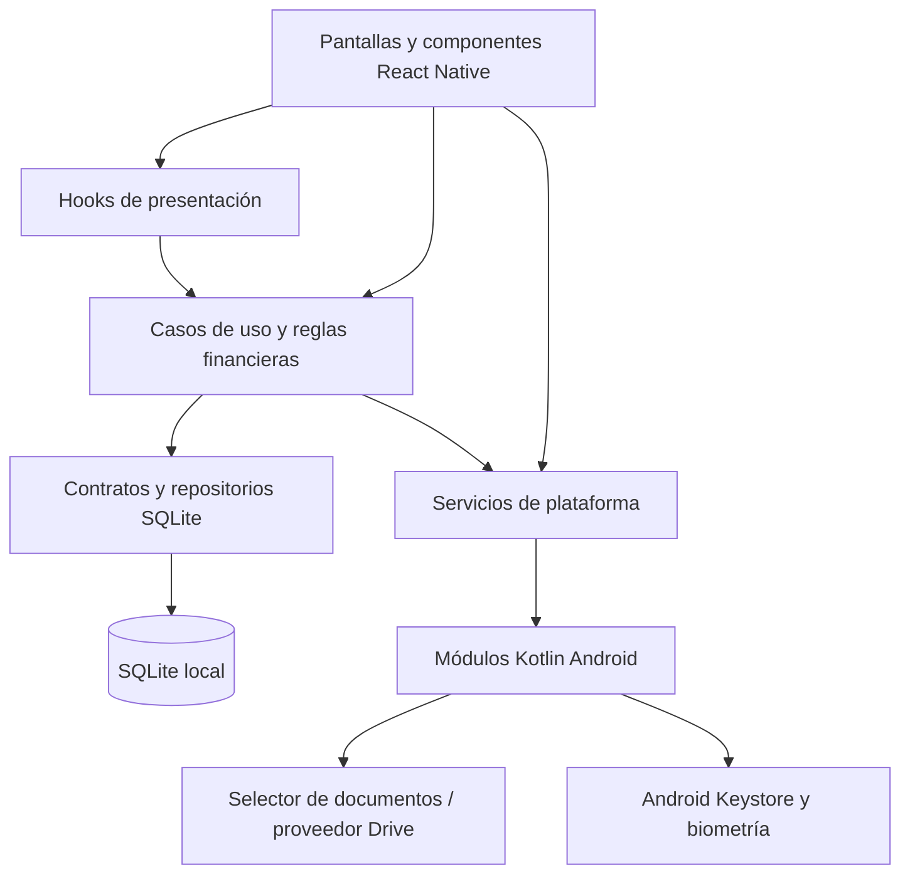
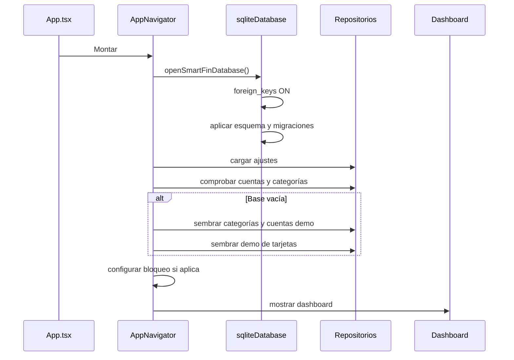
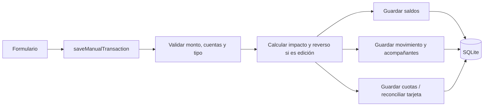

# Arquitectura

## 1. Resumen

SmartFin es una aplicación React Native con dominio y persistencia escritos en TypeScript, SQLite local y dos puentes nativos Kotlin para Android. La arquitectura se organiza por capacidades de negocio y separa interfaz, coordinación, reglas y almacenamiento.



## 2. Capas y reglas

| Capa | Ubicación | Responsabilidad |
|---|---|---|
| Composición | `src/app`, `src/navigation` | Arranque, navegación, ciclo de vida y dependencias |
| UI | `src/modules/*/ui` | Presentación, entrada del usuario y estados visuales |
| Hooks | `src/modules/*/hooks` | Carga y coordinación de estado de presentación |
| Dominio | `src/modules/*/useCases` | Validaciones, cálculos y reglas financieras |
| Persistencia | `src/modules/*/repositories` | Contratos y consultas de cada módulo |
| Base compartida | `src/database` | Conexión, esquema, migraciones ligeras y lectura segura |
| Plataforma | `src/modules/*/services`, `android/...` | Biometría, almacenamiento seguro y exportación |
| Compartido | `src/shared` | Tipos, componentes y utilidades sin dueño de módulo |

Reglas de dependencia:

1. La UI puede llamar hooks y casos de uso, pero no consulta SQLite.
2. Los casos de uso dependen de contratos de repositorio, no de pantallas.
3. Los repositorios traducen entre filas SQLite y tipos de dominio.
4. Las integraciones Android se exponen mediante servicios TypeScript que validan datos `unknown`.
5. Las reglas reutilizables no se duplican en componentes.

## 3. Organización por módulos

Los módulos soportados son `dashboard`, `transactions`, `accounts`, `categories`, `budgets`, `creditCards`, `loans`, `goals`, `subscriptions`, `reports`, `security` y `settings`.

Una capacidad completa puede contener:

```text
src/modules/<feature>/
├── ui/             # pantallas y componentes
├── hooks/          # estado de presentación
├── useCases/       # reglas de negocio
├── repositories/   # persistencia y contratos
├── services/       # límites de plataforma
├── database/       # seed o soporte específico
├── types/          # tipos de dominio
└── index.ts         # API pública del módulo
```

Los módulos `budgets`, `loans`, `goals` y `reports` son marcadores de estructura: su `index.ts` está vacío y no representan funcionalidad disponible.

## 4. Secuencia de arranque



La conexión se comparte mediante una promesa a nivel de módulo. Al desmontar el navegador se cierra. Después de exportar un respaldo, se reabre y se reconstruye el repositorio de ajustes.

## 5. Navegación

No se usa una librería de navegación. `AppNavigator` mantiene una unión `AppRoute` y renderiza una pantalla a la vez:

```text
dashboard
├── transactions
├── creditCards
├── debitCards
└── settings
    └── categories
```

La barra inferior comparte accesos a inicio, movimientos y el menú de más opciones. El navegador también coordina:

- el bloqueo global de acceso;
- la actualización del dashboard tras mutaciones;
- borrado y re-seed;
- estado de respaldo;
- borradores de transferencia enviados desde cuentas débito.

## 6. Persistencia

- Archivo lógico: `smartfin.db`.
- Motor: SQLite embebido.
- Integridad: `PRAGMA foreign_keys = ON`.
- Inicialización: DDL idempotente y migraciones numeradas en `schema_migrations`, con introspección y transacciones.
- Conversión: `sqliteRows.ts` valida primitivas antes de mapearlas.
- Identificadores: texto generado por la aplicación.
- Fechas: cadenas ISO 8601.
- Dinero: números JavaScript y columnas `REAL`, con COP como única moneda de dominio.

El detalle del esquema y las relaciones está en [Base de datos](BASE_DE_DATOS.md).

## 7. Flujo de una escritura financiera

Ejemplo de un movimiento manual:



El caso de uso es responsable de evitar que una edición aplique dos veces el saldo anterior, crear la pata destino de una transferencia y mantener la relación de cuotas.

### Gestión de tarjetas: fase 3B

`saveCreditCardFromForm` y `deleteCreditCard` adquieren el ámbito compartido si no reciben
un participante activo. `reconcileCreditCardTransactions` y la asociación de pendientes
usan el mismo protocolo de repositorios participantes de fase 3A. Los comandos
`saveCreditCardWithAssociations` y `closeCreditCardWithReconciliation` agrupan la acción
de pantalla completa bajo un permiso y un COMMIT: cuenta/perfil, asociación, referencias
de cuotas, deuda/extractos y resolución de alerta, o reconciliación/validaciones/cierre.
Las pantallas delegan la coordinación y presentan efectos después de confirmar.

Las lecturas/validaciones se repiten dentro del ámbito; la edición rechaza una cuenta
obsoleta y la pantalla de tarjetas comprueba también la tasa del perfil. Los resultados
`unknown` conservan la cuarentena y no reintentan el cuerpo financiero. El runner, driver,
esquema y dependencias permanecen sin cambios. [Evidencia y límites](atomicidad-financiera-fase3b.md).

## 8. Integraciones nativas Android

### `SmartFinSecurity`

- Comprueba disponibilidad biométrica y seguridad del dispositivo.
- Presenta `BiometricPrompt`.
- Cifra y descifra la credencial local con AES-GCM.
- Mantiene la clave en Android Keystore y el valor cifrado en preferencias privadas.

### `SmartFinDriveBackup`

- Abre `ACTION_OPEN_DOCUMENT_TREE`.
- Conserva el permiso URI cuando el proveedor lo permite.
- Escribe SQLite, CSV y manifiesto mediante `DocumentsContract`.
- No usa OAuth ni la API de Google Drive.

Los servicios TypeScript comprueban plataforma, presencia de métodos y forma de las respuestas antes de exponer resultados tipados.

## 9. Estado y refresco

El estado es local a componentes y hooks; `src/store` no contiene un store global operativo. `dashboardRefreshKey` funciona como señal de invalidación después de una mutación. Esto es suficiente para la escala actual, aunque un crecimiento de rutas y datos puede justificar un coordinador de navegación y caché más formal.

El historial de movimientos carga páginas de 50 mediante `useTransactionsList` → `getTransactionPage`. Los filtros se consultan sobre toda la base y el selector de meses usa una consulta independiente. `SectionList.onEndReached` solicita la página siguiente. Cada generación corresponde a base, filtros, búsqueda, orden y refresh; respuestas obsoletas se cancelan entre consultas y nunca se anexan a otra generación. Las mutaciones invalidan los cursores mediante la revisión financiera existente. Un refresco conserva la profundidad ya cargada; un filtro nuevo comienza en la primera página. `transactions` y `filteredTransactions` del hook representan las filas cargadas de la consulta activa, no un snapshot completo; ningún otro consumidor usa ese hook.

`getTransactions()` conserva su contrato, SQL y consumidores completos: tarjetas, reconciliación, edición/eliminación contable e IA. No se sustituyen con páginas ni se alteran reglas financieras. [Contrato, equivalencia, rendimiento y límites de fase 3](performance/transactions-phase3.md).

La fase 3.1 mantiene pantalla, hook y cursores. El adaptador del historial conserva, por conexión y revisión financiera, como máximo ocho comprobaciones de orden y ocho búsquedas completas sin coincidencias. No guarda movimientos en esa caché. Solo reutiliza un vacío si los filtros son idénticos y la nueva búsqueda en minúsculas contiene literalmente la anterior. Una escritura invalida las comprobaciones; una cancelación o cambio concurrente nunca publica un resultado reutilizable. [Mediciones y límites](performance/transactions-phase31.md).

## 10. Decisiones y compromisos actuales

| Decisión | Beneficio | Compromiso |
|---|---|---|
| SQLite local | Privacidad y operación offline | Sin sincronización entre dispositivos |
| Arquitectura por feature | Cambios acotados y ownership claro | Puede duplicar contratos si no se cuida la API pública |
| Navegación propia | Pocas dependencias | Historial, deep links y transiciones son limitados |
| Números JS para dinero | Simplicidad | Riesgo de precisión; los flujos actuales redondean importes sensibles |
| Metadatos en `description` | Evita migraciones tempranas | Menor consultabilidad y contrato implícito |
| DDL idempotente y migraciones versionadas | Instalaciones anteriores conservadas | Versiones 1, 2, 3 y 4 aplicadas transaccionalmente |
| Mocks como seed y fallback | Desarrollo rápido | Los datos demo pueden confundirse con datos reales si no se distinguen |

## 11. Límites para nuevas capacidades

- Un backend o sincronización debe entrar detrás de interfaces de repositorio/servicio.
- Ninguna pantalla nueva debe importar `react-native-sqlite-storage`.
- Una regla financiera nueva debe tener un caso de uso puro o inyectable y pruebas.
- Una nueva respuesta nativa debe tratarse como `unknown` y validarse.
- Los cambios de esquema deben mantener compatibilidad con bases ya instaladas.

## Fechas y gastos compartidos

Los movimientos distinguen fecha civil sin hora de fecha y hora explícitas en
`America/Bogota`. La UI de Movimientos y la IA usan este contrato; los datos
históricos mantienen su cadena y día visible hasta una edición explícita.

`transactions/useCases/createSharedExpenseApi.ts` coordina contactos locales,
compras, participaciones, cobros, aplicaciones, devoluciones y cancelaciones
dentro del ámbito SQLite compartido. El importe bancario y la deuda de tarjeta
conservan el total de la compra; la proyección de estadísticas usa la parte propia.
El patrimonio agrega cuentas por cobrar y descuenta anticipos de terceros.
El dashboard obtiene únicamente esos totales mediante
`SharedExpenseRepository.getFinancialTotals()`: una lectura SQLite agregada,
sin cargar contactos, repartos ni historial a JavaScript. El dominio completo
sigue disponible para comandos e historial. La consulta no escribe proyecciones,
no cambia el esquema y valida centavos enteros antes de convertir a pesos.
Cada comando persistente devuelve movimientos y efectos financieros; repetirlo
con los mismos datos devuelve su resultado confirmado.

La migración 3 añade metadatos de fecha, amplía `transaction_splits` y crea seis
tablas. Gastos compartidos dispone de API y pruebas; su interfaz queda pendiente.
[Contrato, esquema, escenarios y validación](GASTOS_COMPARTIDOS_Y_FECHAS.md).

## Condonaciones y recuperación de pérdidas

La migración 4 añade `shared_loss_events`. Comandos puros de Movimientos validan
condonación, recuperación y reversión; la fachada los ejecuta en el ámbito
transaccional e idempotente existente. Su proyección contable se separa del libro
bancario. Dashboard usa agregados, sin cargar el diario completo. No hay UI nueva.
[Contrato, efectos, trazabilidad y límites](CONDONACIONES_COMPARTIDAS.md).

## Suscripciones y mantenimiento local

La fase 4 conserva los ámbitos SQLite y añade consumo durable de planes IA dentro
del mismo commit, mediante comprobantes internos en ai_command_drafts. El catálogo
de generación lleva una revisión persistida; las acciones releen datos vigentes y
rechazan conflictos. El hook publica el éxito después del commit y conserva el
bloqueo ante unknown. Los recordatorios no convierten un éxito financiero en error.

Suscripciones comparte ámbito exterior al crear categoría/subcategoría con sus
derivados. Sus demás mutaciones conservan el generador transaccional existente.
Inicio, primer plano, pantalla y Headless consolidan mantenimiento concurrente y
liberan el permiso entre lotes. La revisión se vuelve a comprobar antes de terminar
para incluir escritores intercalados. No se cambia el driver, esquema o Kotlin.
[Implementación, pruebas y límites de fase 4](atomicidad-financiera-fase4.md).

Suscripciones separa contratos de repositorio, casos de uso puros/injectables, adaptador SQLite y servicio de plataforma. Las mutaciones leen y escriben mediante un generador avanzado desde callbacks SQLite; no hay callbacks async dentro de una transacción. La intención de recordatorios se confirma junto al dominio y sus efectos Android se recuperan después del commit.

WorkManager invoca Headless JS sobre ReactHost sin montar pantallas. Reutiliza los casos de uso TypeScript; Kotlin solo controla alarmas, notificaciones y ciclo de vida. La composición raíz ejecuta mantenimiento al iniciar/volver al primer plano. Un coordinador serializa mantenimiento y operaciones públicas con respaldo/cierre y borrado. [Contrato completo](SUSCRIPCIONES.md).

La interfaz reside en `src/modules/subscriptions/ui/`, con controladores en `hooks/` y transformación/validación del formulario en `useCases/subscriptionPresentation.ts`. Consume exclusivamente la fachada; no consulta SQLite. Los hooks sincronizan al regresar al primer plano y bloquean envíos duplicados. Los componentes nativos comparten paletas clara/oscura, Manrope local bajo OFL, márgenes de 20 y tarjetas de radio 24. El HTML exportado de Stitch se conserva únicamente como referencia en `docs/design/subscriptions/`.

## Coordinación Android y captura privada (fase 5B.1)

`databaseCoordination.ts` conserva la cola JS y adquiere después un dueño nativo
exclusivo. Los llamadores Kotlin de JS reciben su token explícito; los receptores
independientes adquieren participación antes de abrir y la retienen hasta cerrar
SQLite y terminar el efecto protegido. Los tokens tienen dueño, generación y
revocación. WorkManager no conserva esa participación mientras espera Headless.
Las esperas, copia e integridad nativas ejecutan fuera del hilo principal.

En fase 5D el receptor de entrega adquiere un dueño nativo exclusivo propio,
sin esperar JS, y lo retiene hasta cerrar su conexión. Valida y copia el contenido,
publica fuera de una transacción SQLite y confirma después con UPDATE condicional.
Los receptores de recuperación siguen encolando sin retener permisos mientras
Headless JS trabaja. [Garantías y límites de entrega](atomicidad-financiera-fase5d.md).

`settings/services/localDatabaseSnapshot.ts` ofrece captura local privada, sin
conectarla al botón/publicador SAF existente. Comprueba journal/checkpoint,
metadatos/FK/integridad, cierra con recibo, copia y valida en Kotlin y reabre/verifica
la conexión administrada antes de liberar. Una reapertura revalida al dueño nativo.
Timeout de recibo o destrucción del host conservan cuarentena hasta reinicio del
proceso. No se libera una operación activa por tiempo ni se reintentan finanzas.
La cobertura nativa corresponde al proceso actual del manifest; no constituye IPC.

El respaldo externo conserva su contrato y sus limitaciones: esta fase no añade
generaciones, publicación verificada, restauración ni limpieza financiera durable.
[Implementación, campañas y límites](atomicidad-financiera-fase5b1.md).

### Publicación por generaciones (fase 5B.2, activación pendiente)

El publicador heredado de nombres fijos se sustituye por
`SmartFinBackupPublisher`: trabajos privados recuperables con `AtomicFile`, CSV
leídos exclusivamente del snapshot validado, archivos SAF exclusivos por UUID y
manifiesto v2 final. La captura entrega el handle recuperado y libera los permisos
antes de exportar/publicar. Descubrimiento y recuperación verifican tamaños y
SHA-256; un fallo externo conserva incertidumbre y evidencia, sin truncar archivos.
No hay limpieza automática ni cambios financieros. La raíz histórica permanece
congelada y legible, sin certificación retrospectiva. La interfaz está preparada
pero desactivada mediante `BACKUP_PUBLICATION_UI_ENABLED`, hasta aceptar el contrato
de lectores externos y los tiempos de bloqueo.
[Protocolo, compatibilidad y validación](atomicidad-financiera-fase5b2.md).
