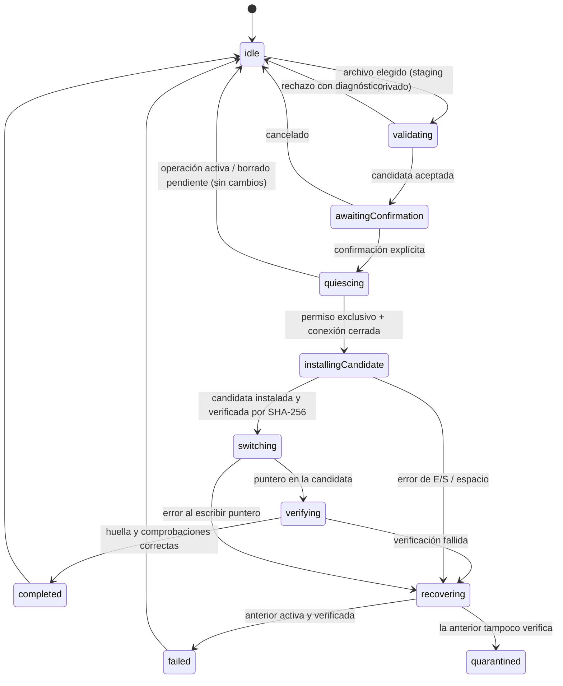

# Diseño de restauración segura de SmartFin (Etapa C1, R1)

7 de noviembre de 2026. Documento de diseño: **no implementa nada en la aplicación**. Rama `main`, HEAD `0f566ee`
(descendiente de `b3ef6e5`). Sin commit, sin push, sin cambios en `src/`, `android/`, migraciones, triggers,
interfaz ni `BACKUP_PUBLICATION_UI_ENABLED`. Base: [auditoría de respaldo y restauración](auditoria-respaldo-restauracion-fase1a4B.md).

## 1. Resumen ejecutivo

SmartFin no tiene restauración (R1). Este diseño propone una **restauración completa y explícita** (nunca una fusión)
basada en tres piezas:

1. **Validación en copia privada**: el archivo elegido por el usuario se copia a almacenamiento privado y sólo esa copia
   se examina; el original nunca se abre en escritura. Las versiones futuras o incompletas se rechazan; las antiguas
   conocidas se migran únicamente en la copia y se revalidan desde cero.
2. **Generaciones con puntero y diario** (recomendada): la candidata se instala como un archivo nuevo
   `smartfin-<restoreId>.db` y la base activa se elige mediante un puntero pequeño escrito con `AtomicFile`. La base
   anterior **no se modifica ni se borra** durante la restauración; un diario durable permite completar o revertir tras
   un cierre o un reinicio. No se renombra nada encima de `smartfin.db`, así que el journal de una base nunca se aplica a
   otra.
3. **Verificación financiera posterior** con huella canónica de contenido: la restauración sólo cuenta como completada
   si la base activa, abierta con el arranque real, tiene exactamente el contenido validado de la candidata.

La prueba de concepto aislada ([`__tests__/restoreProtocolPocC1.test.ts`](../__tests__/restoreProtocolPocC1.test.ts),
14/14) muestra que, inyectando un cierre en cada uno de los 13 puntos del protocolo, la recuperación deja siempre activa
la base anterior o la candidata completa, nunca una mezcla ni una base vacía, y sin tocar el archivo elegido ni la base
anterior. **No valida Android**: es Node sobre Windows, con fallos simulados.

Bloqueo arquitectónico identificado: el nombre `smartfin.db` está fijo en tres abridores (`sqliteSchema.ts` para el
driver JS, `SmartFinLocalSnapshot.kt` y `SmartFinSubscriptionRemindersModule.withDatabase`). La opción recomendada exige
un **resolvedor único** de la base activa antes de C3. Hay una alternativa sin cambio de nombre (opción C, sección 10.4).

## 2. Estado actual demostrado

| Hecho | Evidencia |
|---|---|
| No existe restauración | Auditoría §5; búsqueda en `src/` y `android/app/src/main/java/com/smartfin/` |
| Publicación deshabilitada | `backupPublicationPolicy.ts`: `BACKUP_PUBLICATION_UI_ENABLED = false`; `performDriveBackup` lanza |
| El driver abre por nombre y crea si falta | `SQLitePlugin.java`: `getDatabasePath(dbname)` con `OPEN_READWRITE | CREATE_IF_NECESSARY` |
| Abridores nativos con nombre fijo | `SmartFinLocalSnapshot.kt:86`, `SmartFinSubscriptionRemindersModule.kt:179` |
| Coordinación | `databaseCoordination.ts` (cola JS única, también para Headless) + `SmartFinDatabaseCoordinator.kt` (dueño exclusivo, participantes, cuarentena) |
| Toda operación JS administrada pasa por la cola | `managedSQLite.ts` `makeHandle` → `withDatabaseMaintenance` salvo con permiso prestado |
| Proceso único | `AndroidManifest.xml` sin `android:process` |
| Copia de seguridad del sistema desactivada | `android:allowBackup="false"` |
| Modo journal | La app no activa WAL; la captura acepta `wal/delete/truncate/persist` |
| Versiones SQLite reales | API 24: 3.9.2; API 35 (dispositivo de validación): 3.44.5 (`docs/atomicidad-financiera-fase11.md`) |
| Versionado de esquema | `schema_migrations` 1–5; `PRAGMA user_version` nunca escrito |
| Epoch de borrado dentro de la base | `SmartFinFinancialDeletion`: clave `__smartfin_financial_lifecycle_v1` en `app_settings` |
| Apertura no valida estructura completa | Auditoría R4: tabla de migración 5 ausente abre sin error |
| Sin control de versión máxima | Auditoría R5 |
| Copia de bytes con escritor abierto | Auditoría R7: pasa `integrity_check` con filas no confirmadas |

## 3. Arquitectura propuesta

```
UI (C5, fuera de C1)            hooks/useCases                         nativo Kotlin
─────────────────────           ───────────────────────────            ────────────────────────────────
Elegir archivo (SAF) ───────▶   restoreFromBackup (caso de uso)  ───▶  SmartFinRestore.stage(uri)        (C2)
Confirmación destructiva        ├─ validateRestoreCandidate        ───▶  SmartFinRestore.inspect(id)      (C2)
                                ├─ withExclusiveDatabase(permit)          SmartFinRestoreJournal (AtomicFile)
                                │   ├─ cerrar conexión administrada       SmartFinDatabaseLocation (resolvedor)
                                │   └─ SmartFinRestore.install/switch ─▶  SmartFinRestore.install/verify  (C3)
                                └─ reabrir, verificar, reprogramar        SmartFinRestore.recover() al arrancar
```

Componentes **reutilizados** (existentes): `withExclusiveDatabase`/`withDatabaseMaintenance`, `nativeDatabaseToken`,
`SmartFinDatabaseCoordinator` (acquire/participate/assertParticipant/quarantine), `closeSmartFinDatabase` y
`openSmartFinDatabase`, `assertCompleteCheckpoint`, el patrón `LocalSnapshotFailure` + `onDatabase` de
`exportDriveBackup` para retirar y reponer la conexión de la UI, `SmartFinLocalSnapshot.describe` (metadatos e
integridad), `SmartFinBackupPublisher.digest` y la validación de manifiestos v2, `AtomicFile` y el patrón de marcador
durable de `SmartFinFinancialDeletion`, los casos de uso 1a.4B para la verificación de idempotencia.

Componentes **nuevos** (en C2–C3, con autorización):

| Componente | Responsabilidad |
|---|---|
| `SmartFinDatabaseLocation.kt` + equivalente TS | Única fuente del nombre/ruta activa; lee el puntero; rechaza abrir si hay diario pendiente |
| `SmartFinRestore.kt` | Staging desde URI, inspección RO, instalación, verificación, recuperación |
| `SmartFinRestoreJournal` | Diario durable (AtomicFile) con fases y huellas |
| `restoreCandidateValidation.ts` (useCase) | Política de versiones, estructura esperada, invariantes financieros |
| `restoreFromBackup.ts` (useCase) | Orquestación, estados públicos, informe de resultado |
| `contentFingerprint` (nativo, para no cargar toda la base en JS) | Huella canónica por tabla (sección 11) |

## 4. Flujo completo de restauración

1. **Selección** (C5): `ACTION_OPEN_DOCUMENT` (API 19+) de un único archivo; nunca un árbol completo. No se confía en el
   MIME. Si existe un manifiesto v2 junto al archivo, se usa como metadato opcional (sección 13).
2. **Staging** (sin permiso de base): copia en streaming desde `ContentResolver.openInputStream(uri)` a
   `noBackupFilesDir/smartfin-restore/<restoreId>/candidate.db`, calculando SHA-256 y tamaño durante la copia;
   `fd.sync()`. El URI se suelta al terminar: la restauración nunca depende de que el URI siga accesible.
3. **Validación** (sección 6) sobre la copia privada. Resultado: candidata aceptada (con huella de contenido, versión de
   origen y resumen financiero) o rechazo con diagnóstico. Ninguna escritura sobre la base activa.
4. **Confirmación explícita** del usuario con el resumen: fecha de captura (si hay manifiesto), versión, número de
   movimientos, cuentas, compras a cuotas, imputaciones activas/revertidas y la advertencia de que **los cambios
   posteriores a esa copia se perderán**. Se recomienda ofrecer antes un respaldo del estado actual (la base anterior se
   conserva igualmente como generación previa, sección 10).
5. **Quiescencia**: `withExclusiveDatabase` (cola JS + dueño nativo exclusivo). Con el permiso: comprobar que la conexión
   no tiene transacción propia (`sqliteConnectionState(...).owned`), comprobar que no hay borrado financiero pendiente
   (`SmartFinFinancialDeletion` marcador/fase), cancelar alarmas de recordatorio del epoch actual
   (reutilizando el inventario del borrado financiero), notificar a la UI (`onDatabase(undefined)`) y cerrar la conexión
   administrada (`closeSmartFinDatabase(permit)`).
6. **Instalación** (nativo, con participante del dueño): diario `staging`; copia de la candidata a
   `databases/smartfin-<restoreId>.db.part` con `fd.sync()`; verificación de SHA-256; `rename` a
   `smartfin-<restoreId>.db`; sync del directorio.
7. **Conmutación**: diario `switching`; puntero con `{active, previous, restoreId, contentDigest}` mediante `AtomicFile`;
   sync del directorio; diario `verifying`.
8. **Verificación**: `openSmartFinDatabase(permit)` con el resolvedor (arranque real: esquema, migraciones,
   `foreign_key_check`, `integrity_check`, revisión) y comprobación de huella y resumen financiero (sección 11).
9. **Completar**: diario `completed`; nueva identidad de dataset (decisión §19); reprogramación de recordatorios desde la
   base restaurada; reposición de repositorios en la UI; liberar el permiso. Después, borrar el diario.
10. **Fallo en 6–8**: puntero de vuelta a la generación anterior, diario `failed`, candidata conservada para diagnóstico,
    reapertura de la anterior y su verificación, informe al usuario.

## 5. Diagrama de estados



| Estado | ¿Persistido? | Dónde | Motivo |
|---|---|---|---|
| idle, validating, awaitingConfirmation, quiescing | No | Memoria | No hay ningún cambio sobre la base activa; un cierre sólo deja un staging que se descarta |
| installingCandidate (`staging`) | **Sí** | Diario | Puede quedar un `.part` o una generación sin activar |
| switching | **Sí** | Diario + puntero | El puntero puede o no haber cambiado |
| verifying | **Sí** | Diario | La candidata está activa sin verificar |
| completed / failed | **Sí** (hasta reconciliar) | Diario | Reprogramaciones y limpieza pendientes |
| quarantined | **Sí** | Diario + cuarentena del coordinador | Requiere intervención; no se abre nada automáticamente |

## 6. Validaciones previas

Todas sobre la copia privada. El archivo del usuario sólo se lee (stream) durante el staging.

| # | Comprobación | Modo | Fallo ⇒ |
|---|---|---|---|
| 1 | Existencia, lectura completa, tamaño > 0; SHA-256 del stream | Stream | Rechazo |
| 2 | Cabecera `SQLite format 3\0`; tamaño de página válido; `page_count × page_size == tamaño` | Bytes | Rechazo (truncado) |
| 3 | Límites: tamaño ≤ máximo (p. ej. 512 MiB) y espacio libre ≥ 3 × tamaño (`StatFs.getAvailableBytes`, API 18; `getAllocatableBytes` es API 26 y **no** sirve en API 24) | Bytes | Rechazo sin copiar |
| 4 | Cabecera WAL (bytes 18–19 = 2): normalizar con `PRAGMA journal_mode=DELETE` **sólo en la copia de trabajo** | Copia RW aislada | Si falla: rechazo |
| 5 | `PRAGMA integrity_check` (no `quick_check`: hay que validar índices) | RO | Rechazo |
| 6 | `PRAGMA foreign_keys=ON` + `PRAGMA foreign_key_check` (Android omite el PRAGMA de configuración en conexiones RO; se ejecuta explícitamente, como ya hace la captura) | RO | Rechazo |
| 7 | `PRAGMA user_version` = 0 (valor actual de todas las bases SmartFin) | RO | Rechazo: origen desconocido |
| 8 | `schema_migrations`: existe, versiones contiguas 1..N; N > 5 ⇒ futuro | RO | Rechazo (sección 7) |
| 9 | Tablas y columnas esperadas (por nombre, `PRAGMA table_info`: tipo, `notnull`, `dflt_value`, `pk`), sin tablas desconocidas | RO | Rechazo con lista |
| 10 | Índices (nombre + SQL normalizado) y triggers necesarios (nombre + SQL normalizado), incluidos guards y `backup_revision_*` de la migración 5 | RO | Rechazo |
| 11 | Estructuras de la migración 5 completas: 4 tablas, 2 índices, triggers de validación, transición, guards de pago/compra y de revisión | RO | Rechazo |
| 12 | `financial_data_revision`: una fila `id=1`, entero seguro ≥ 0 | RO | Rechazo |
| 13 | Imputaciones: cada una con compra o historial; activas con pago `creditCardPayment` existente y revisión `allocation` con su `allocation_id`; `command_id` único por compra | RO | Rechazo |
| 14 | Revisiones: numeración contigua desde 0 por compra; `pendingVerification` ⇔ motivos; `allocationReversal` con imputación `reversed` | RO | Rechazo |
| 15 | Compras ↔ movimiento original ↔ tarjeta (`account_id` de tipo `creditCard`); pagos ↔ tarjeta destino | RO | Rechazo |
| 16 | Importes: centavos enteros seguros en tablas 1a.3B+; REAL finitos en el libro heredado (sin redondear) | RO | Rechazo |
| 17 | Marcador de borrado financiero en fase `cleanupPending` | RO | Rechazo (copia tomada a mitad de un borrado) |
| 18 | Esquema antiguo: migración en copia de trabajo y **repetir 5–16 desde cero** | Copia RW aislada | Rechazo si la migración o la revalidación falla |

Notas de plataforma: en API 24 no existen `pragma_table_info()` (3.16), `table_xinfo` (3.26) ni el alias `sqlite_schema`
(3.33). Hay que usar `PRAGMA table_info(...)` y `sqlite_master`. Una apertura RO de una base con journal caliente
falla; el staging nunca lleva journal, así que no aplica.

Las comprobaciones 9–11 no pueden comparar el texto de `CREATE TABLE` (ALTER ADD COLUMN reescribe el texto almacenado
y cambia el orden). Riesgo pendiente: instalaciones antiguas podrían tener triggers con texto distinto del actual
(sección 18).

## 7. Compatibilidad de versiones

| Candidata | Política |
|---|---|
| Versión 5 (actual) | Compatible tras validación completa |
| Versiones 1–4 | Sólo migrando la **copia de trabajo** con `applyVersionedMigrations` (el mismo código del arranque) y revalidando desde cero. La activa nunca ve una base sin migrar |
| Sin `schema_migrations` (anterior a la versión 1) | Rechazo hasta disponer de una base real de esa época para probarla |
| Versión > 5 (futura) | Rechazo seguro: no se abre en escritura en ningún momento, ni siquiera en la copia de trabajo |
| Esquema incompleto o con tablas desconocidas | Rechazo con diagnóstico (lista de diferencias) |

No se modifica la migración 5 ni se crea la 6. **Dependencia**: el arranque normal debería rechazar también versiones
futuras e incompletas (R4, R5); si no, una restauración correcta podría convivir con una apertura permisiva de bases
corruptas. Se propone resolverlo en C2 con autorización.

## 8. Coordinación de conexiones

| Necesidad | Mecanismo real |
|---|---|
| Impedir nuevas operaciones financieras JS | Mantener el permiso de `withExclusiveDatabase` durante quiescing → verifying: toda llamada administrada espera en la cola `pending` |
| Headless JS (suscripciones) | Mismo runtime y misma cola (`databaseCoordination.ts`) |
| Receptores y Worker nativos | `participate(null)` sólo se concede sin dueño exclusivo ni cola; con el dueño tomado esperan 2 s y fallan (sus rutas ya se recuperan después). `acquire` del receptor espera al dueño |
| Operaciones pendientes | No se aborta nada en curso: `acquire` espera a `independent == 0`; `release` espera a `participants == 0`, sin timeout |
| Transacción activa | Se rechaza la restauración (estado `quiescing → idle`) si `sqliteConnectionState().owned` |
| Cerrar todas las conexiones | Conexión administrada: `closeSmartFinDatabase(permit)` con recibo; nativas: sólo existen dentro de participantes, que no pueden concederse mientras el permiso está tomado; las RO de validación son de otro archivo |
| Referencias a la base anterior | Las conexiones JS antiguas pasan a `closed` y rechazan cualquier uso; la UI recibe `onDatabase(undefined)` y luego la nueva conexión y repositorios (patrón existente) |
| Reapertura | `openSmartFinDatabase(permit)` resuelve el nombre activo y aplica el arranque completo |
| Fallos de cierre o recibo | Cuarentena existente hasta reinicio del proceso; la recuperación se ejecuta al siguiente arranque |

No se usa ninguna demora temporal. Cerrar la conexión JS no basta por sí solo: la garantía viene de que todo abridor
del proceso pase por el coordinador. **Requisito de C3**: auditar que no exista ningún `SQLiteDatabase.openDatabase` sin
participante (hoy: driver JS, `SmartFinLocalSnapshot`, `withDatabase` de recordatorios y `SmartFinBackupCsv` sobre la
copia privada) y añadir una prueba estática que lo vigile.

## 9. Política de WAL y archivos auxiliares

- **Base activa**: modo rollback (la app no activa WAL). La generación anterior conserva **sus propios** `-journal`,
  `-wal` y `-shm`, que nunca se tocan: si tenía un journal caliente, SQLite lo aplicará a ese mismo archivo si vuelve a
  ser la activa. Esta es la principal ventaja frente a renombrar sobre `smartfin.db`.
- **Candidata**: se instala sin auxiliares, normalizada a `DELETE`. Antes del `rename` final se comprueba que no existan
  `smartfin-<restoreId>.db-journal/-wal/-shm`.
- **Base anterior en WAL** (por compatibilidad): antes de conmutar, `wal_checkpoint(TRUNCATE)` con resultado completo
  (`assertCompleteCheckpoint`), igual que la captura. No es imprescindible para la seguridad (sus auxiliares viajan con
  ella), pero deja un estado limpio para un posible regreso.
- **Limpieza**: sólo de generaciones que no son activas ni `previous`, mediante `SQLiteDatabase.deleteDatabase(File)`
  (API 16, borra base y auxiliares), nunca borrando auxiliares a mano.

## 10. Sustitución y recuperación

### 10.1 Opciones evaluadas

| Opción | Descripción | Veredicto |
|---|---|---|
| A. Renombrar sobre `smartfin.db` | `smartfin.db → previa`, `candidata → smartfin.db` | **Rechazada**. Dos renombrados: entre ambos no existe `smartfin.db` y cualquier apertura (`CREATE_IF_NECESSARY`) crea una base vacía (R6). Un `smartfin.db-journal` caliente de la base anterior se aplicaría a la candidata y la corrompería |
| **B. Generaciones + puntero + diario** | Archivo nuevo por restauración; el puntero (`AtomicFile`) elige la activa | **Recomendada**. Un único cambio atómico pequeño; la anterior intacta; recuperación determinista. Requiere resolvedor único y espacio para dos bases |
| C. Reescritura transaccional en sitio | `ATTACH` de la candidata y, en una transacción, vaciar e insertar todas las tablas | **Alternativa** (10.4). Atomicidad garantizada por SQLite en API 24 y 35, sin cambiar el nombre; exige retirar y recrear triggers dentro de la transacción |
| D. API de backup de SQLite / `VACUUM INTO` | — | **No disponible**: `android.database.sqlite` no expone `sqlite3_backup_*`; `VACUUM INTO` requiere SQLite 3.27 (API 24 tiene 3.9.2). Necesitaría empaquetar otro SQLite (dependencia nueva, no autorizada) |

### 10.2 Protocolo B

Ubicaciones: candidata en `noBackupFilesDir/smartfin-restore/<id>/` durante el staging; generación instalada en
`getDatabasePath()`'s directorio (`databases/`), porque el driver sólo abre nombres simples de ese directorio; puntero y
diario en `noBackupFilesDir` (como los marcadores actuales).

```
puntero  smartfin-active.json   {formatVersion:1, active, previous?, restoreId?, contentDigest?}   (AtomicFile)
diario   smartfin-restore-journal.json {formatVersion:1, id, phase, candidate, previous, contentDigest, stagedSha256,
                                        sourceSchemaVersion, migratedFrom?, createdAt}               (AtomicFile)
ausencia de puntero ⇒ active = "smartfin.db" (compatibilidad con todas las instalaciones actuales)
```

Durabilidad: `AtomicFile.finishWrite` sincroniza el archivo, pero no el directorio. Tras cada `rename` se sincroniza el
directorio con `android.system.Os.open(dir, O_RDONLY)` + `Os.fsync` (API 21). Debe verificarse en API 24 y 35 (C4); si el
sistema de archivos no lo admite, el diseño sigue siendo seguro porque **el puntero es autodescriptivo**
(`previous`, `restoreId`, `contentDigest`): sin diario, la recuperación verifica la activa contra su huella y, si no
coincide, vuelve a `previous`.

Garantías que se afirman y que no:

- Sí: `rename(2)` dentro del mismo sistema de archivos reemplaza **un** archivo de forma atómica (POSIX; ext4/f2fs).
  `AtomicFile` garantiza que un lector ve el contenido viejo o el nuevo.
- No: no se afirma atomicidad de varios archivos. Por eso sólo se conmuta un archivo (el puntero) y todo lo demás es
  aditivo y recuperable.

### 10.3 Recuperación al arrancar

Se ejecuta en nativo **antes de cualquier apertura**, con dueño exclusivo, desde `openSmartFinDatabase` (JS). Los
abridores nativos independientes que encuentren un diario pendiente **no abren**: devuelven «no disponible», como hoy
cuando falta el archivo, y dejan la recuperación a la ruta exclusiva.

| Diario | Puntero | Acción |
|---|---|---|
| Ninguno | Cualquiera | Borrar `*.tmp`/`.part` huérfanos; si el puntero tiene `contentDigest`, comprobar que la activa existe |
| `staging` | anterior | Revertir: borrar `.part` y la generación no activada; borrar diario |
| `switching` / `verifying` | anterior | Igual que `staging` |
| `switching` / `verifying` | candidata | Verificar candidata. Correcta ⇒ `completed`. Incorrecta ⇒ puntero a `previous`, `failed`, conservar candidata |
| `failed` | cualquiera | Asegurar puntero en `previous`; conservar candidata; borrar diario tras registrar el resultado |
| `completed` | candidata | Terminar reprogramación y limpieza; borrar diario |
| Cualquiera | La activa no abre ni verifica y `previous` tampoco | `quarantined`: no se abre nada; se informa; no se crea base vacía |

La PoC ejercita exactamente estas reglas en sus 13 puntos de cierre: 1 limpio antes de empezar, 6 reversiones
(puntos 2–7, hasta el `.tmp` del puntero), 5 terminaciones (8–12, desde el `rename` del puntero) y 1 limpio tras completar.
En los 13 la base activa fue la anterior o la candidata completa, el archivo anterior conservó su SHA-256 y una segunda
recuperación devolvió «limpio».

### 10.4 Alternativa C (si no se autoriza el resolvedor)

Con permiso exclusivo y la conexión normal: snapshot de protección (captura existente), `ATTACH` de la candidata validada,
`PRAGMA defer_foreign_keys=ON` (3.8.0, disponible en API 24), en **una** transacción: `DROP TRIGGER` de todos los triggers,
`DELETE` y `INSERT ... SELECT` tabla por tabla conservando `rowid`, recrear triggers con su SQL original, comparar la
huella canónica con la de la candidata **antes del COMMIT** y hacer `ROLLBACK` si difiere. Ventajas: atomicidad de SQLite,
sin cambios de nombre ni de abridores. Riesgos: modifica triggers en ejecución (decisión explícita, aunque no cambie su
definición), reescritura completa (journal ≈ tamaño de la base) y lógica de copia propensa a omisiones, mitigada con la
huella previa al COMMIT. La base anterior sólo sobrevive en el snapshot de protección.

## 11. Verificación financiera posterior

La restauración no se completa porque SQLite abra. Se exige, sobre la base activa abierta con el arranque real:

1. `integrity_check = ok`, `foreign_key_check` vacío, `foreign_keys = 1` (ya en `openSmartFinDatabase`).
2. Estructura (sección 6, 9–11) y versión 5.
3. **Huella canónica** igual a la calculada en la validación: SHA-256 de todas las tablas, todas las columnas, en orden
   determinista, calculada en nativo para no cargar la base en JS. Esto demuestra que la activa es la copia elegida y no
   una combinación con la anterior. La PoC comprobó que abrir una candidata actual con el arranque real **no** altera ni
   sus bytes.
4. Resumen financiero igual al mostrado en la confirmación: saldos por cuenta, deuda y cupo de tarjetas, número de
   movimientos, extractos, compras a cuotas, imputaciones activas/revertidas, revisiones por compra y por estado de
   verificación y motivo (`pendingVerification`, `statementAdjustmentRequired`, `lazyInitialRevision`, `allocationReversed`),
   reglas de facturación y primeros ciclos, `financial_data_revision`.
5. Invariantes 13–16 de la sección 6 repetidos sobre la activa.
6. Comprobación de idempotencia **sin escrituras**: para una muestra de `command_id` presentes, la consulta de evidencia
   (`getAllocationsByCommand`) devuelve el mismo estado. No se ejecutan comandos financieros en la verificación.

Límites conservados: no se reconstruyen comandos originales tras edición o borrado del pago (limitación A de
`pendientes-fase1a4B.md`); no se confirma información bancaria; las revisiones pendientes siguen pendientes.

`financial_data_revision` vuelve al valor de la copia. Por R3, eso no identifica el contenido (sección 13).

## 12. Tratamiento de errores

| Error | Respuesta |
|---|---|
| Rechazo de validación | Informe con diagnósticos; staging borrado; nada cambia |
| Usuario cancela | Staging borrado |
| Operación financiera activa o borrado pendiente | «Reintenta al terminar»; sin cambios |
| Sin espacio antes de instalar | Rechazo sin escribir en `databases/` |
| Sin espacio o E/S durante la copia del `.part` | `recovering` ⇒ borrar `.part`, diario fuera, anterior activa y reabierta |
| Fallo al renombrar | Igual que lo anterior (la generación no está activa) |
| Fallo al escribir el puntero | Diario `switching`; la recuperación decide por el valor real del puntero |
| Verificación fallida | `failed`, puntero a `previous`, candidata conservada |
| La anterior tampoco abre | `quarantined`; ninguna base vacía; mensaje para restaurar otra copia |
| Timeout de recibo SQLite | Cuarentena existente; recuperación en el siguiente arranque |

Los mensajes nunca dicen «restaurado» antes de `completed`.

## 13. SAF, fuentes de respaldo e identidad (R2, R3)

**Fuente frente a restauración.** La fuente sólo entrega bytes (un URI SAF, o en el futuro la generación v2). La
restauración empieza en el staging privado y no depende del proveedor después de copiar.

- Hoy no hay ninguna ruta de selección: `SmartFinDriveBackupModule` sólo abre un árbol de carpeta
  (`ACTION_OPEN_DOCUMENT_TREE`) para publicar. Componente necesario (C5): un selector `ACTION_OPEN_DOCUMENT` de un único
  documento con permiso de lectura temporal (sin persistir), o un listado de generaciones v2 verificadas en la carpeta ya
  autorizada (reutilizando `discover` y `validate`).
- Se mantiene `BACKUP_PUBLICATION_UI_ENABLED = false`. Restaurar no exige publicar.
- Proveedores en la nube (Drive) pueden descargar bajo demanda: un fallo de red a mitad del stream deja un staging
  incompleto, detectado por tamaño/SHA-256 del manifiesto o por la cabecera y la integridad.

**R3: identidad.** `financial_data_revision` cuenta escrituras en tablas financieras mediante triggers; dos historias
distintas con el mismo número de escrituras coinciden (auditoría R3), y una restauración lo devuelve a un valor pasado.
Propuesta de conceptos separados (no se implementan en C1):

| Concepto | Hoy | Propuesta |
|---|---|---|
| Versión de esquema | `schema_migrations` | Igual; rechazo de futuras |
| Identidad de la base (instalación/historia) | No existe (el epoch de borrado sólo cambia al borrar) | `datasetId` UUID en `app_settings` (tabla no rastreada por la revisión); nuevo al instalar, al borrar y **al restaurar** |
| Revisión de cambios | `financial_data_revision` | Igual, sólo dentro de un mismo `datasetId` |
| Identidad de la instantánea | `snapshot.id` / `generationId` | Igual; se registra en el manifiesto y en la confirmación |
| Integridad del archivo | SHA-256 de componentes | Igual (integridad, **no** autenticidad) |
| Fecha de captura | `generatedAt` del manifiesto | Igual |
| Huella de contenido | No existe | Huella canónica (sección 11), calculada en la captura y en la restauración; nunca sustituye al contador para detectar cambios en caliente, porque recalcularla tras cada escritura sería costoso |

Restaurar cambia el `datasetId`, por lo que ninguna generación publicada antes podrá aparecer como «al día» por
coincidencia de contador. Requiere decisión (sección 19).

**Epoch de borrado y recordatorios.** La copia trae su `__smartfin_financial_lifecycle_v1`. Antes de conmutar hay que
cancelar alarmas y notificaciones del epoch actual (inventario existente) y, tras verificar, reprogramar desde
`subscription_reminders` de la base restaurada. Los trabajos de publicación del dataset anterior quedan históricos por el
cambio de `datasetId`.

## 14. Modelo de amenazas y fallos

| Escenario | Qué debe ocurrir | Archivos conservados | Recuperación |
|---|---|---|---|
| Archivo corrupto | Rechazo en validación (integridad o SHA-256 del manifiesto) | Activa intacta | Ninguna necesaria |
| Archivo truncado | Rechazo (cabecera/tamaño de páginas/integridad) | Activa intacta | — |
| SQLite válido con esquema incorrecto | Rechazo con diferencias | Activa | — |
| Versión futura | Rechazo sin abrir en escritura | Activa | — |
| Versión antigua | Migración sólo en copia de trabajo y revalidación | Activa y archivo elegido intactos | — |
| Respaldo de otra instalación | Se acepta si es válido (es el caso de uso de cambio de teléfono), pero la confirmación muestra su `datasetId`/fecha y advierte; tras restaurar se asigna un `datasetId` nuevo | Activa como `previous` | Regresar a `previous` (decisión de producto, §19) |
| Falta de espacio | Rechazo previo; si ocurre durante la copia, `.part` borrado | Activa | Automática |
| Error de permisos SAF / pérdida de URI | Falla el staging; nada cambia. Tras el staging, el URI ya no se usa | Activa | Elegir de nuevo |
| Proceso terminado durante la restauración | Diario + recuperación al arrancar (PoC: 13/13 puntos) | Activa anterior siempre intacta | Automática |
| Reinicio del dispositivo | Igual; durabilidad con sync de archivo y directorio; puntero autodescriptivo | Igual | Automática |
| Transacción financiera activa | La restauración espera al permiso; si la conexión tiene transacción propia, se rechaza sin cambios | Activa | Reintento |
| WAL con operaciones recientes | Checkpoint TRUNCATE completo antes de conmutar; los auxiliares viajan con su base | Activa con su WAL | — |
| Copia incompleta (`.part`) | Nunca activa (sólo se renombra tras SHA-256) | Activa | Borrado en recuperación |
| Error al abrir la nueva base | `failed` y vuelta a `previous` | Candidata para diagnóstico | Automática |
| Error al recuperar la base anterior | `quarantined`, sin crear base vacía | Ambas generaciones | Manual: restaurar otra copia o soporte |
| Doble pulsación / ejecución simultánea | Cerrojo de proceso + diario pendiente ⇒ la segunda se rechaza (PoC) | — | — |
| Repetir una restauración completada | Si la huella de la activa coincide con la candidata ⇒ «ya está activa», sin nueva generación (PoC) | — | — |
| Manipulación maliciosa del archivo | Las relaciones manipuladas que conservan estructura y FK se detectan con invariantes (PoC); un archivo coherente pero falso **no** se puede detectar | — | — |

**Confidencialidad y autenticidad.** Los respaldos actuales van sin cifrar (`encrypted: false`) y un SHA-256 sólo prueba
que el archivo no cambió respecto a un manifiesto **que viaja con él**: quien pueda escribir en la carpeta puede cambiar
ambos. Para autenticidad haría falta firmar o MAC-ear el manifiesto con una clave del Keystore; eso sólo vale para el
mismo dispositivo (la clave no viaja), así que la restauración en otro teléfono seguiría sin autenticidad. Se propone:
mostrar siempre el origen y la fecha, tratar toda copia como no confiable y validar contenido, y dejar la firma o el
cifrado para una decisión aparte. Además, el archivo elegido nunca se ejecuta: sólo se lee como datos, y las rutas que
contiene no se usan.

## 15. Matriz de pruebas

| Prueba | Node (fiable) | API 24 instrumental | API 35 instrumental |
|---|---|---|---|
| Validación de candidatas (cabecera, tamaño, integridad, FK, versiones, estructura, invariantes) | **Sí** (PoC: 9 casos) | Repetir sobre SQLite 3.9.2 (PRAGMAs disponibles) | Repetir (3.44.5) |
| Migración de esquemas antiguos en copia | Sí (v4 reconstruido) | Sí, con bases reales antiguas | Sí |
| Huella canónica y comparación financiera | Sí | Equivalencia Node–Android de la huella | Ídem |
| Idempotencia tras restaurar | Sí (PoC y auditoría) | Sí | Sí |
| Protocolo de estados con cierres inyectados | Sí, como modelo (PoC 13/13) | **Imprescindible**: fallos reales de E/S, `kill -9` en cada fase | Ídem |
| `rename`, `AtomicFile`, `Os.fsync` de directorio | **No** (Windows/Node) | Sí | Sí |
| SAF: stream, pérdida de permiso, proveedor lento | No | Sí (proveedor local) | Sí (proveedor local y Drive si se autoriza) |
| Coordinador: quiescencia, receptores, Worker, Headless | No | Sí | Sí |
| Cierre y reapertura del driver, repositorios de la UI | No | Sí | Sí |
| Falta de espacio | Parcial (simulada) | Sí (llenar `noBackupFilesDir`/`databases`) | Sí |
| Recuperación tras reinicio del dispositivo | No | Sí (manual o `adb reboot` en campaña) | Sí |

Sin instrumentación nativa no se declara ninguna cobertura Android.

## 16. Plan por etapas

| Etapa | Archivos | Componentes nuevos | Riesgos | Pruebas | Aceptación | Depende de | Producción | Esquema |
|---|---|---|---|---|---|---|---|---|
| **C1 Diseño** (esta) | Solo docs y PoC en `__tests__/` | — | Diseño no validado en dispositivo | PoC Node | Este documento aprobado | Auditoría | No | No |
| **C2 Validación de candidatas** | Nuevo `src/modules/settings/useCases/restoreCandidateValidation.ts`; nuevo `SmartFinRestore.kt` (staging + inspect RO); `SmartFinDatabaseLifecycleModule.kt` (métodos); `nativeDatabaseLifecycle.ts` (tipos); opcional R4/R5 en `sqliteDatabase.ts`/`migrations.ts` (validación, sin tocar la migración 5) | Validador, huella nativa, staging | Falsos rechazos de bases antiguas legítimas | Node (matriz) + pruebas JVM/instrumentales del staging | Ninguna escritura fuera de `noBackupFilesDir/smartfin-restore`; 0 cambios en la activa | C1 | Sí (aditivo, sin UI) | No |
| **C3 Restauración y recuperación** | Nuevo `SmartFinDatabaseLocation.kt` + resolvedor TS; `sqliteDatabase.ts` (nombre resuelto); `SmartFinLocalSnapshot.kt` y `SmartFinSubscriptionRemindersModule.kt` (resolvedor); nuevo `restoreFromBackup.ts`; `SmartFinRestore.kt` (install/switch/verify/recover); integración con `SmartFinFinancialDeletion` (admisión) | Diario, puntero, recuperación al arrancar, `datasetId` (si se autoriza) | Abridor olvidado ⇒ escritura en la generación equivocada; recordatorios desalineados | Node + prueba estática de abridores + instrumental básica | PoC reproducida con el código real; todos los abridores pasan por el resolvedor | C2; decisiones §19 | Sí | No (sólo una clave en `app_settings` si se aprueba `datasetId`) |
| **C4 Validación Android** | `scripts/phase-restore/*`, `docs/validacion-restauracion/` | Arnés instrumental | Diferencias de sistema de archivos entre fabricantes | API 24 y 35: matriz §15 con fallos inyectados y `kill` en cada fase | 0 estados mezclados, 0 bases vacías, equivalencia Node | C3; autorización de compilar e instalar | No | No |
| **C5 Habilitación** | `SettingsScreen`/`DriveBackupSection` (selector y confirmación), textos | Selector `ACTION_OPEN_DOCUMENT`, pantalla de confirmación | Confusión con la publicación deshabilitada | Interfaz + campaña final | Respaldo y restauración completos demostrados; R2 decidido aparte | C4 | Sí (UI) | No |

Ninguna etapa se ejecuta sin autorización explícita.

## 17. Archivos a modificar (resumen futuro)

- Nuevos: `src/modules/settings/useCases/restoreCandidateValidation.ts`, `src/modules/settings/useCases/restoreFromBackup.ts`,
  `src/database/databaseLocation.ts`, `android/app/src/main/java/com/smartfin/SmartFinRestore.kt`,
  `android/app/src/main/java/com/smartfin/SmartFinDatabaseLocation.kt`, pruebas Node e instrumentales.
- Modificados: `src/database/sqliteDatabase.ts`, `src/database/nativeDatabaseLifecycle.ts`,
  `android/app/src/main/java/com/smartfin/SmartFinDatabaseLifecycleModule.kt`, `SmartFinLocalSnapshot.kt`,
  `SmartFinSubscriptionRemindersModule.kt`, `SmartFinFinancialDeletion.kt` (admisión cruzada), y en C5 la interfaz de
  Ajustes.
- Sin cambios: migraciones 1–5, triggers, casos de uso financieros, CSV, `BACKUP_PUBLICATION_UI_ENABLED`.

## 18. Riesgos pendientes

1. **Abridor fuera del resolvedor** (opción B): escribiría en la generación anterior. Mitigación: resolvedor único,
   prueba estática y verificación del puntero dentro de `withDatabase`.
2. **Triggers con texto histórico distinto** en instalaciones antiguas: la validación estricta podría rechazar copias
   legítimas. Hace falta reunir esquemas de bases reales de versiones anteriores (sintéticas generadas con builds viejos)
   antes de fijar la política.
3. **Sync de directorio** no verificado en dispositivo; mitigado por el puntero autodescriptivo.
4. **Espacio**: hasta tres copias (staging, generación nueva, anterior). Política de limpieza de `previous` pendiente.
5. **Recordatorios y epoch** tras restaurar: reconciliación con el mantenimiento existente sin duplicar notificaciones.
6. **Autenticidad** de respaldos: no resoluble con SHA-256 (sección 14).
7. **R4/R5 en el arranque normal**: sin ellos, la restauración es más estricta que la apertura diaria.
8. **R7** sigue vigente para la captura; la restauración no lo agrava porque la candidata se valida completa.
9. **Bases muy grandes** (100 000 movimientos ≈ 50 años): medir tiempos de integridad, huella y copia en API 24 (C4).

## 19. Decisiones que requieren autorización

1. Opción **B** (generaciones + puntero, con resolvedor único) o **C** (reescritura transaccional en sitio).
2. Introducir `datasetId` en `app_settings` (R3) y regenerarlo al restaurar.
3. Aplicar R4/R5 (validación de estructura y versión máxima) en la apertura normal durante C2.
4. Política de bases sin `schema_migrations` (anteriores a la versión 1): rechazar o investigar.
5. Retención de la generación anterior: hasta la siguiente restauración, durante N días o hasta confirmación del usuario.
6. Restaurar copias de otra instalación (cambio de teléfono): permitido con advertencia o bloqueado.
7. Ofrecer un respaldo del estado actual antes de restaurar, teniendo en cuenta que la publicación sigue deshabilitada.
8. Autenticidad o cifrado de respaldos.
9. Política de `.gitattributes` (R10), independiente de la restauración.

## 20. Recomendación final

Implementar en el orden C2 → C3 → C4 → C5, con la **opción B**:

- C2 primero porque es aditiva y no toca la base activa, y porque obliga a fijar la política de versiones y la huella
  que C3 necesita.
- El resolvedor único es el único cambio estructural de C3 y conviene hacerlo antes que cualquier interfaz.
- La PoC justifica el protocolo, pero sólo C4 (API 24 y 35, con `kill` y fallos reales de E/S) puede demostrar la
  seguridad en Android.

Criterios de C1 cubiertos por el diseño: validar antes de usar (§6–7), proteger la base activa (§10: nunca se modifica),
restaurar de forma recuperable (§5, §10.3), resistir interrupciones (PoC 13/13, §14), verificar la integridad financiera
(§11), rechazar esquemas incompatibles (§7), evitar duplicaciones (huella, idempotencia sin escrituras, «ya está activa»)
y reanudar con seguridad (§8: reapertura con el arranque real antes de liberar el permiso).

## Anexo A. Técnicas realmente disponibles

| Técnica | API 24 (SQLite 3.9.2) | API 35 (SQLite 3.44.5) | Uso en el diseño |
|---|---|---|---|
| `PRAGMA integrity_check`, `quick_check` | Sí | Sí | Validación |
| `PRAGMA foreign_key_check` | Sí (3.7.16) | Sí | Validación |
| `PRAGMA defer_foreign_keys` | Sí (3.8.0) | Sí | Opción C |
| `ATTACH DATABASE` | Sí | Sí | Opción C (el driver expone `attach`) |
| `PRAGMA table_info` / `sqlite_master` | Sí | Sí | Estructura |
| `pragma_table_info()`, `table_xinfo`, `sqlite_schema` | **No** | Sí | No usar |
| `VACUUM INTO` | **No** (3.27) | Sí | No usar |
| `sqlite3_backup_*` desde Java | **No** (sin API pública) | **No** | No usar |
| `SQLiteDatabase.OPEN_READONLY` | Sí | Sí | Inspección |
| `SQLiteDatabase.deleteDatabase(File)` | Sí (API 16) | Sí | Limpieza de generaciones |
| `android.util.AtomicFile` | Sí (API 17) | Sí | Puntero y diario |
| `android.system.Os.rename/fsync/open` | Sí (API 21) | Sí | Durabilidad |
| `StatFs.getAvailableBytes` | Sí (API 18) | Sí | Espacio |
| `StorageManager.getAllocatableBytes` | **No** (API 26) | Sí | No usar como requisito |
| `ACTION_OPEN_DOCUMENT` + `openInputStream` | Sí (API 19) | Sí | Fuente |
| `noBackupFilesDir` | Sí (API 21) | Sí | Staging, puntero, diario |

## Anexo B. Prueba de concepto

[`__tests__/restoreProtocolPocC1.test.ts`](../__tests__/restoreProtocolPocC1.test.ts): **descartable**, sólo datos
sintéticos, sin tocar `src/` ni `android/`. 14 pruebas: 9 de validación (actual aceptada sin modificar el archivo,
truncado, cabecera alterada, no SQLite, vacío, versión 6, tabla ausente, relación manipulada con estructura y FK
correctas, v4 migrado sólo en copia) y 5 de protocolo (éxito sin tocar la anterior y repetición «ya está activa», cierre
en los 13 puntos, verificación fallida con vuelta atrás, doble ejecución, idempotencia y operación única tras restaurar).
`SMARTFIN_POC_C1_EVIDENCE=<archivo>` vuelca los resultados por punto de cierre.
