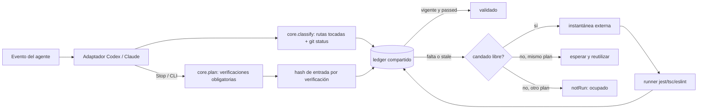

# financial-integrity-guard — Auditoría y diseño (fase previa a la implementación)

> Estado: **propuesta, sin implementar**. Fecha de la auditoría: 30 de octubre de 2026
> (America/Bogota). Autor: sesión de Claude Code a petición del usuario.
> Este documento es autocontenido: Codex y Claude Code deben poder implementarlo sin
> depender de la conversación que lo originó.
>
> Durante la auditoría **no se modificó ningún archivo existente**, no se ejecutaron
> pruebas Jest, campañas Android, migraciones ni instalaciones. El único archivo creado
> es este documento.

## 0. Resumen ejecutivo

- `financial-integrity-guard` (FIG) será un segundo sistema de hooks, **independiente** de
  `dangerous-command-guard` (DG). DG decide *antes* de ejecutar una herramienta si una
  operación es peligrosa; FIG observa *después* de editar qué código financiero cambió,
  qué pruebas lo cubren y si el resultado vigente sigue aprobado. No comparten reglas.
- Núcleo único en Node (CommonJS, sin dependencias nuevas) y dos adaptadores finos:
  Codex (`SessionStart`, `PostToolUse`, `Stop`) y Claude Code (los mismos eventos, con
  contratos distintos). Ningún adaptador ejecuta pruebas en `PostToolUse`.
- Las pruebas se ejecutan sobre una **instantánea materializada fuera del checkout**,
  porque 11 suites de la ejecución por defecto reescriben evidencias versionadas en
  `docs/` (hallazgo G1). Así FIG no ensucia el árbol ni compite con otro agente.
- Resultados direccionados por contenido (SHA-256 de código, pruebas, configuración y
  versión del propio guard), con un candado exclusivo por checkout para que Codex y
  Claude nunca ejecuten simultáneamente lo mismo y reutilicen las evidencias del otro.
- Estados: `passed`, `failed`, `skipped`, `notRun`, `timeout`, `error`, `stale`. Un alcance
  solo es **validado** si todas sus verificaciones obligatorias son `passed` y su hash de
  entrada coincide con el contenido actual.
- La instalación en `.claude/` y `.codex/` tendrá que hacerla el usuario: DG protege
  esas rutas frente a escrituras del agente (DG-FILE), igual que ocurrió con el runner 6B.2.

---

## 1. Fuentes revisadas y contraste con el código

| Fuente | Contraste realizado | Resultado |
|---|---|---|
| `AGENTS.md`, `CLAUDE.md` | Reglas de capas, privacidad y volúmenes | Vigentes; se respetan en el diseño |
| `docs/ARQUITECTURA.md` | Capas, módulos, fases 3B–5B.2 | Coherente con `src/`; `budgets/loans/goals/reports` siguen vacíos |
| `docs/BASE_DE_DATOS.md` | 39 tablas, migraciones, centavos en dominio compartido | Coherente; el resumen inicial sigue mencionando tablas "preparadas" sin módulo |
| `.claude/skills/smartfin-financial-domain/SKILL.md` (copias idénticas en `.codex/skills/` y `.agents/skills/`) | Tabla de áreas y reglas | El mapa base está fechado el 11/10/2026; su nota sobre ausencia de gastos compartidos/devoluciones está **superada** por `createSharedExpenseApi.ts` y sus suites (la propia skill lo advierte) |
| `docs/dangerous-command-guard.md`, `docs/dangerous-command-guard-claude.md` | Contratos, versiones, protecciones | Codex `0.166.0-alpha.5.1` y Claude Code `2.1.316` confirmados localmente |
| `jest.config.js`, `package.json` | Patrón de pruebas, scripts | `testMatch` excluye `*.test.js` (hallazgo G2) |
| `git status` (inicio y durante la auditoría) | Cambios locales | Trabajo concurrente activo de la fase 6B.3 (sección 9.1) |

Versiones verificadas en este equipo durante la auditoría:

| Componente | Versión | Cómo se verificó |
|---|---|---|
| Claude Code | 2.1.316 | `claude --version` |
| Codex CLI (Desktop) | 0.166.0-alpha.5.1 | `C:\Users\nesto\AppData\Local\OpenAI\Codex\bin\22cfb1d302613eae\codex.exe --version` (no está en el `PATH` de las shells del agente) |
| Node | 24.16.0 | `node --version` (`node:sqlite` disponible; las pruebas exigen ≥ 22.13, `package.json` declara ≥ 22.11) |
| Jest / TypeScript / ESLint | ^29.6.3 / ^5.8.3 / ^8.19.0 | `package.json` (no se ejecutaron) |

---

## 2. Mapa de archivos financieros sensibles

Niveles de sensibilidad usados por la política de FIG:

- **N1 – Núcleo financiero**: calcula o persiste saldos, deuda, ingresos/gastos o patrimonio, o
  define el límite transaccional. Cualquier cambio exige verificación obligatoria.
- **N2 – Soporte financiero**: tipos, utilidades monetarias, lectura/validación de filas,
  hooks y pantallas que invocan casos de uso o transforman importes. Exige pruebas relacionadas.
- **N3 – Infraestructura de verificación**: pruebas, helpers, fixtures y configuración de
  ejecución. Su cambio invalida los resultados que dependen de ellos y se reporta aparte
  (un cambio en pruebas nunca "valida" por sí mismo un cambio en N1).

### 2.1 N1 – Núcleo financiero

| Área | Archivos |
|---|---|
| SQLite, atomicidad y coordinación | `src/database/atomicSQLite.ts`, `sqliteRepositoryScope.ts`, `managedSQLite.ts`, `databaseCoordination.ts`, `nativeDatabaseLifecycle.ts`, `sqliteLifecycle.ts`, `sqliteDatabase.ts`, `sqliteSchema.ts`, `migrations.ts`, `upsertSQLiteRow.ts`, `sqliteRows.ts` |
| Cuentas y saldos | `src/modules/accounts/useCases/manageDebitCards.ts`, `getDebitCardsOverview.ts`; `repositories/sqliteAccountRepository.ts`, `saveSqliteAccounts.ts` |
| Movimientos, transferencias, 4×1000 | `src/modules/transactions/useCases/saveManualTransaction.ts`, `manualTransactionScope.ts`, `updateTransactionQuickly.ts`, `getManualTransactionFormOptions.ts`; `repositories/sqliteTransactionRepository.ts`, `sqliteTransactionHistory.ts` |
| IA que escribe finanzas | `transactions/useCases/aiCommandPlanner.ts`, `executeAiCommandPlan.ts`; `repositories/aiCommandReceipt.ts`, `sqliteAiDraftRepository.ts` |
| Gastos compartidos, cobros, devoluciones, condonaciones | `transactions/useCases/createSharedExpenseApi.ts`, `sharedExpenseDomain.ts`, `sharedCommandEffects.ts`, `sharedLossDomain.ts`, `sharedLossCommands.ts`, `readSharedFinancialTotals.ts`; `repositories/sqliteSharedExpenseRepository.ts`, `SharedExpenseRepository.ts`, `sharedTransactionIntegrity.ts`, `sharedCommandResultValidation.ts`, `sqliteSharedCommandReads.ts`, `sharedFinancialProjectionSql.ts`, `sharedFinancialTotalsSql.ts`, `sharedLossPeriodSql.ts`; `database/sharedExpenseSchema.ts`, `sharedLossSchema.ts` |
| Tarjetas: pagos, compras, cuotas, extractos | `src/modules/creditCards/useCases/creditCardTransactionRelations.ts`, `creditCardPaymentScope.ts`, `creditCardManagementScope.ts`, `creditCardManagementCommands.ts`, `manageCreditCards.ts`, `getCreditCardsOverview.ts`; `repositories/sqliteCreditCardRepository.ts`, `readCreditCardReconciliationTransactions.ts`, `readUnclassifiedCreditTransactions.ts`, `sqliteCreditCardAlertRepository.ts` |
| Suscripciones y conciliación de cobros | `src/modules/subscriptions/useCases/subscriptionLifecycle.ts`, `recurrence.ts`, `createSubscriptionApi.ts`, `createSubscriptionInCommand.ts`, `subscriptionFromAiFields.ts`; `repositories/sqliteSubscriptionRepository.ts`, `SubscriptionRepository.ts`; `database/schema.ts`; `services/subscriptionRuntime.ts` |
| Dashboard y patrimonio | `src/modules/dashboard/useCases/getDashboardSummary.ts` |
| Categorías (recategorización conserva totales) | `src/modules/categories/useCases/manageCategories.ts`, `manageSubcategories.ts`; `repositories/sqliteCategoryRepository.ts`, `sqliteSubcategoryRepository.ts` |
| Borrado, respaldo y recuperación | `src/modules/settings/useCases/deleteFinancialData.ts`; `repositories/sqliteFinancialDataRepository.ts`; `services/financialDeletionLifecycle.ts`, `localDatabaseSnapshot.ts`, `androidDriveBackupService.ts`, `backupPublicationPolicy.ts`, `settingsTaskOwner.ts` |
| Nativo Android (solo verificable con campañas autorizadas) | `android/app/src/main/java/com/smartfin/SmartFinDatabaseCoordinator.kt`, `SmartFinDatabaseLifecycleModule.kt`, `SmartFinLocalSnapshot.kt`, `SmartFinBackupPublisher.kt`, `SmartFinBackupCsv.kt`, `SmartFinFinancialDeletion.kt`, `SmartFinSubscriptionWorker.kt`, `SmartFinSubscriptionReminderReceiver.kt`, `SmartFinSubscriptionRemindersModule.kt`, `SmartFinDriveBackupModule.kt` |
| Parches del driver | `scripts/patchReactNativeSqliteStorage.js`, `scripts/sqliteAndroidRecoveryPatch.js` |

### 2.2 N2 – Soporte financiero

- Tipos: `src/shared/types/finance.ts`, `src/modules/*/types/**`.
- Precisión COP: `src/shared/utils/exactCopCents.ts`, `copAmountInput.ts`, `formatCurrency.ts`,
  `transactionDate.ts`, `stableJson.ts`.
- Hooks: `dashboard/hooks/useDashboardSummary.ts`, `accounts/hooks/useDebitCardsOverview.ts`,
  `creditCards/hooks/useCreditCardsOverview.ts`, `transactions/hooks/useTransactionsList.ts`,
  `useAiAssistantController.ts`, `subscriptions/hooks/*`.
- Pantallas que invocan casos de uso o transforman importes: `TransactionsScreen.tsx` (acciones
  rápidas), `components/AddTransactionModal.tsx`, `CategorizationModal.tsx`, `TransactionCard.tsx`,
  `transactionsScreenFormatters.ts`, `AiAssistantScreen.tsx`; `CreditCardsScreen.tsx`,
  `components/CreditCardPayment.tsx`, `CreditCardFormModal.tsx`; `DebitCardsScreen.tsx`,
  `DebitCardFormModal.tsx`; `subscriptions/ui/*` y `useCases/subscriptionPresentation.ts`;
  `settings/ui/components/DangerZoneSection.tsx`, `DriveBackupSection.tsx`; `src/navigation/AppNavigator.tsx`
  (seed, borrado, refresco tras mutación).
- Semillas: `src/database/seedSmartFinDatabase.ts`, `creditCards/database/seedCreditCardDemoData.ts`.

### 2.3 Fuera del alcance financiero (no disparan FIG)

`src/modules/security/**`, `src/native/speechRecognition.ts`, estilos/paletas
(`*Palette.ts`, `*Styles.ts`, `transactionsTheme.ts`), `ModulePlaceholder.tsx`, `BottomNavigation.tsx`,
módulos vacíos `budgets/loans/goals/reports`, documentación. `src/services/geminiCommandService.ts`
es una integración de red ya existente: FIG no la llama ni la prueba con red; las pruebas de IA
que importan el planificador sí se seleccionan.

---

## 3. Inventario de pruebas existentes

Jest ejecuta `__tests__/**/*.test.ts(x)`: **71 archivos**. Hay **4** `*.test.js` que la
configuración por defecto **no ejecuta** (G2). Helpers en `__tests__/helpers/` (34 archivos),
incluidos oráculos congelados (`pre6B1*`, `pre6B2*`, `phase*`, `post3B*`) y SQLite real
(`realSQLite.ts`, `node:sqlite` en memoria).

| Dominio | Suites (por defecto) |
|---|---|
| Saldos, movimientos, transferencias, 4×1000 | `financialIntegrity`, `saveManualTransaction`, `transactionsScreen`, `transactionAccountFilter`, `transactionDates`, `aiTransfers`, `debitCardManagement`, `debitCardsOverview` |
| Tarjetas, pagos, compras, cuotas, extractos | `creditCardTransactionRelations`, `creditCardsOverview`, `creditCardRepository`, `creditCardPaymentScreen`, `creditCardFormatters`, `creditCardAssociationScaling`, `creditCardReconciliationBaseline`, `creditCardReconciliationEquivalence` |
| Gastos compartidos, cobros, devoluciones, condonaciones | `sharedExpenses`, `sharedForgiveness`, `sharedFinancialTotals`, `sharedCommandReads`, `sharedCommandReaderWait`, `sharedSQLiteCoordination` |
| Suscripciones | `subscriptions`, `subscriptionRecurrence`, `subscriptionPresentation`, `subscriptionInterface`, `subscriptionAtomicityPhase4`, `subscriptionMaintenanceComparison`, `aiSubscriptions` |
| IA | `aiCommandPlanner`, `aiDraftRepository`, `aiConfirmationPhase4`, `geminiCommandService` |
| Dashboard y precisión | `dashboardSummary`, `dashboardAggregatesPhase6B2`, `dashboardPhase6APrecision`, `dashboardPhase5E3Precision`, `dashboardPhase5E5PrecisionDiagnostic`, `dashboardPhase5E2Diagnostic`*, `dashboardPerformance`*, `copAmountInput` |
| Atomicidad, COMMIT/ROLLBACK | `financialAtomicityInfrastructure`, `financialAtomicityPhase0` (con snapshot), `Phase2`, `Phase3A`, `Phase3B`, `Phase4`, `Phase5E`, `Phase5E1`, `financialAuditPhase6B`, `financialCorrectionPhase6B1` |
| Concurrencia y ciclo de vida | `sharedSQLiteCoordination`, `localSnapshotCoordination`, `settingsTaskOwner`, `sqliteRecoveryLifecycle`, `sqliteAndroidRecoveryPatch` |
| Borrado, respaldo y recuperación | `financialDataRepository`, `financialDeletionBaseline`, `financialDeletionPhase5C`, `financialDeletionRecoveryPhase5E4`, `backupPublication`, `backupControls`, `backupCsvPhase5E6`, `backupCsvYearQueryPhase5E4`, `backupRecoverabilityPhase5E5`, `driveBackupService` |
| Historial y volumen | `transactionHistoryPagination`, `transactionHistoryRefinement`, `transactionHistoryPhase5E2`, `Phase5E2RangePlan`, `Phase5E3`, `Phase5E3FiftyYears`, `useTransactionsPagination`, `representativeHistory`, `transactionHistoryPerformance`*, `Phase5E2Diagnostic`*, `Phase5E2Performance`*, `Phase5E2ProofPlans`*, `transactionHistoryRefinementPerformance`* |
| Categorías, ajustes, seguridad | `categoryManagement`, `settingsRepository`, `manageSecurity` |
| Temporales / en curso | `zzTieBreakProbe` (sonda de 5E.2 cuya eliminación está pendiente según `aceptacion-integrada-fase5e3.md`), `phase6b3Reproduction` (**sin versionar**, trabajo 6B.3 en curso) |
| No ejecutadas por defecto (`*.test.js`) | `integrationAudit`, `sharedCommandPerformance`, `sharedForgivenessPerformance`, `sharedPositionPerformance` |

`*` = el cuerpo pesado está condicionado por variable de entorno (`test.skip` sin ella).
Variables que habilitan volumen/diagnóstico: `SMARTFIN_5E3_LARGE`, `SMARTFIN_5E4_LARGE`,
`SMARTFIN_6A_EVIDENCE`, `SMARTFIN_6A_BENCHMARK`, `SMARTFIN_5E2_*`, `SMARTFIN_5E3_DIAGNOSTIC`,
`SMARTFIN_5E5_DIAGNOSTIC`, `SMARTFIN_HISTORY_BENCHMARK`, `SMARTFIN_HISTORY_REFINEMENT`,
`SMARTFIN_DASHBOARD_BENCHMARK`, `SMARTFIN_COMMAND_PERF`, `SMARTFIN_FORGIVENESS_PERF`,
`SMARTFIN_PHASE2_REPORT`, `SMARTFIN_PHASE3A_REPORT`, `SMARTFIN_PHASE3B_REPORT`,
`SMARTFIN_5E5_*`, `SMARTFIN_5E6_*`, `PHASE6B2_REPRODUCTION`, `PHASE6B3_REPRODUCTION`.
FIG **debe borrar todas estas variables** del entorno de sus ejecuciones salvo en el nivel
completo autorizado.

Pruebas de los hooks existentes (no financieras, `node --test`): `.codex/hooks/__tests__/dangerous-command-guard.test.cjs`
(140), `.claude/hooks/__tests__/*.test.cjs` (170). FIG no las ejecuta ni las modifica.

### 3.1 Pruebas que escriben evidencias en el repositorio

**Escriben siempre en la ejecución por defecto** (sin variable de entorno):

| Suite | Archivo escrito |
|---|---|
| `creditCardReconciliationEquivalence` | `docs/atomicidad-fase3a1/node-equivalence.json` |
| `creditCardReconciliationBaseline` | `docs/atomicidad-fase3a1/baseline/node-baseline.json` (solo si no existe) |
| `dashboardAggregatesPhase6B2` | `docs/correccion-fase6b2/node/results.json` |
| `financialAtomicityPhase4` | `docs/atomicidad-fase4/node-ia-matrix.json` |
| `financialAtomicityPhase5E` | `docs/atomicidad-fase5e/node/integration.json` |
| `financialCorrectionPhase6B1` | `docs/correccion-fase6b1/node/results.json` |
| `financialAuditPhase6B` | `docs/auditoria-fase6b/node/probes.json` |
| `financialDeletionPhase5C` | `docs/atomicidad-fase5c/node-matrix.json` |
| `subscriptionAtomicityPhase4` | `docs/atomicidad-fase4/node-subscriptions-matrix.json` |
| `subscriptionMaintenanceComparison` | `docs/atomicidad-fase4/node-maintenance-comparison.json` |
| `sharedCommandReaderWait` | `docs/performance/shared-commands/node-reader-wait.json` |

**Escriben solo con variable de entorno**: `dashboardPhase5E3Precision`, `dashboardPhase5E5PrecisionDiagnostic`,
`dashboardPhase6APrecision`, `dashboardPhase5E2Diagnostic`, `dashboardPerformance`, `transactionHistoryPerformance`,
`transactionHistoryRefinementPerformance`, `transactionHistoryPhase5E2Diagnostic/Performance/ProofPlans`,
`financialAtomicityPhase2/3A/3B` (ruta en variable), `backupCsvPhase5E6`, `backupRecoverabilityPhase5E5`
(además mutan copias en directorios temporales propios), `phase6b3Reproduction`.
**Fuera de Jest por defecto**: `integrationAudit.test.js` → `docs/audit/`, `sharedPositionPerformance.test.js` →
`docs/performance/shared-position/`. El snapshot `__snapshots__/financialAtomicityPhase0.test.ts.snap`
no debe reescribirse: FIG usará `--ci`.

Evidencia del efecto: al cerrar la auditoría, `git status` mostraba **7 evidencias modificadas**
de esa tabla, producidas por ejecuciones recientes de otro agente.

---

## 4. Matriz de cobertura financiera

Leyenda: **I** implementado y con suites que ejercen el resultado; **P** parcial; **N** no implementado
(solo tipos/tablas o nada). "Node" significa SQLite real en memoria vía `node:sqlite`; no acredita el
driver Android ni Kotlin.

| Funcionalidad | Estado | Implementación | Evidencia automatizada | Límite / brecha |
|---|---|---|---|---|
| Saldos de cuentas | I | `saveManualTransaction`, `manageDebitCards`, `saveSqliteAccounts` | `financialIntegrity`, `saveManualTransaction`, `debitCard*`, `financialAtomicityPhase0/2` | El impacto manual no filtra por estado (regla observada, no defecto) |
| Transferencias | I | patas `<id>` / `<id>-in` en `saveManualTransaction`, IA | `financialIntegrity`, `aiTransfers`, `transactionAccountFilter`, `financialAtomicityPhase2` | — |
| Pagos de tarjeta | I | `registerCreditCardPayment` / `creditCardPaymentScope` | `creditCardTransactionRelations`, `creditCardPaymentScreen`, `financialAtomicityPhase3A`, `financialCorrectionPhase6B1` | **En modificación (6B.3)** al cerrar la auditoría |
| Compras y cuotas | I | `installment_purchases`, reconciliación | `creditCardsOverview`, `creditCardRepository`, `creditCardReconciliation*`, `financialAtomicityPhase3B` | Reinicio de `paidInstallments` al cambiar condiciones: comportamiento observado |
| Impuesto 4×1000 | I | acompañante `<id>-4x1000`, `Math.max(1, round(amount*0.004))` | `saveManualTransaction`, `financialIntegrity`, `transactionsScreen`, `transactionDates`, `aiTransfers`, `financialAtomicityPhase0/2`, `financialAuditPhase6B`, `financialCorrectionPhase6B1`, `dashboardAggregatesPhase6B2` | — |
| Gastos compartidos y cobros | P | API `createSharedExpenseApi` + repositorio | `sharedExpenses`, `sharedFinancialTotals`, `sharedCommandReads`, `sharedSQLiteCoordination` | **Sin UI**; la API es la superficie probada |
| Devoluciones | P | Solo dentro del dominio compartido (`sharedTransactionIntegrity`) | `sharedExpenses`, `sharedCommandReads` | Tipo `refund` general sin flujo especializado (dashboard lo excluye); no declarar cobertura general |
| Condonaciones / recuperación de pérdidas | P | `sharedLossCommands`, migración 4 | `sharedForgiveness` | Sin UI |
| Suscripciones | I | ciclo de vida, recurrencia, runtime, UI | `subscriptions`, `subscriptionRecurrence`, `subscriptionAtomicityPhase4`, `subscriptionInterface`, `aiSubscriptions`, `subscriptionMaintenanceComparison` | Efectos Android (WorkManager, alarmas) solo simulados en Node |
| Conciliación de tarjetas y extractos | I | `reconcileCreditCardTransactions`, `credit_card_statements` | `creditCardReconciliationEquivalence/Baseline`, `creditCardTransactionRelations`, `financialAtomicityPhase3A/3B` | — |
| Conciliación de cobros de suscripción | I | `confirmPayment` | `subscriptions` | — |
| Importación/conciliación de extractos bancarios | N | No existe código | — | No declarar cobertura |
| Precisión de importes COP | I/P | `exactCopCents`, `copAmountInput`, `formatCurrency`; libro en `REAL` | `copAmountInput`, `dashboardPhase6APrecision`, `dashboardPhase5E3/5E5*`, `dashboardAggregatesPhase6B2`, `financialCorrectionPhase6B1` | Sin migración global a centavos; **en modificación (6B.3)** |
| Dashboard: ingresos, gastos, ahorro, patrimonio | I | `getDashboardSummary`, `SharedExpenseRepository.getFinancialTotals` | `dashboardSummary`, `dashboardAggregatesPhase6B2`, `dashboardPhase6APrecision`, `sharedFinancialTotals` | Rendimiento a 100k solo con variables de entorno |
| Atomicidad SQLite, COMMIT y ROLLBACK | I (Node) | `atomicSQLite`, `sqliteRepositoryScope`, ámbitos por módulo | `financialAtomicityInfrastructure`, `financialAtomicityPhase0…5E1`, `subscriptionAtomicityPhase4`, `financialDeletionPhase5C` | Driver Android: solo campañas manuales documentadas; `unknown` no reintenta |
| Concurrencia financiera | P | `databaseCoordination`, `settingsTaskOwner`, coordinación nativa | `sharedSQLiteCoordination`, `localSnapshotCoordination`, `sharedCommandReaderWait`, `settingsTaskOwner` | Mismo runtime/conexión; IPC y procesos Kotlin no verificables en Node |
| Respaldo | P | snapshot local, CSV, publicador por generaciones | `backupPublication`, `backupCsv*`, `driveBackupService`, `localSnapshotCoordination`, `backupControls` | Publicación por generaciones **desactivada** (`BACKUP_PUBLICATION_UI_ENABLED = false`) |
| Recuperación | P | verificación de artefactos y recuperación del ciclo de vida SQLite | `backupRecoverabilityPhase5E5`, `sqliteRecoveryLifecycle`, `financialDeletionRecoveryPhase5E4` | **No existe flujo de restauración** de respaldos en `src/` |
| Borrado financiero | I | `deleteFinancialData`, `financialDeletionLifecycle` | `financialDataRepository`, `financialDeletion*` | — |
| Préstamos, presupuestos, metas, reportes | N | `index.ts` vacíos; tablas y tipo de cuenta `loan` existen | — | No declarar cobertura |

---

## 5. Brechas encontradas

| ID | Brecha | Impacto en FIG | Tratamiento propuesto |
|---|---|---|---|
| G1 | 11 suites por defecto reescriben evidencias versionadas en `docs/` con contenido no determinista | Ejecutar pruebas en el checkout ensucia el árbol, invalida hashes, simula "cambios concurrentes" y puede pisar evidencias de otro agente | Ejecutar siempre en instantánea externa (§6.4). No se tocan las pruebas |
| G2 | `testMatch` excluye `*.test.js` | `integrationAudit` y pruebas de rendimiento nunca corren por defecto | FIG las clasifica como `skipped` (fuera de política); solo nivel completo autorizado |
| G3 | `zzTieBreakProbe.test.ts` sigue presente aunque su eliminación está pendiente | Ruido en selección | Excluida por política; decisión del usuario |
| G4 | Skill financiera con mapa de 11/10 parcialmente superado | Riesgo de seleccionar mal | La política de FIG se deriva del código (grafo de imports), no de la skill |
| G5 | No hay hook posterior a la edición; DG solo actúa en `PreToolUse` | Cambios financieros sin verificación registrada | FIG `PostToolUse` + `Stop` |
| G6 | Garantías Android/Kotlin solo con campañas manuales | Node no acredita driver ni IPC | FIG marca esos alcances como `notRun` con motivo "requiere campaña autorizada"; nunca los lanza |
| G7 | Pantallas con coordinación financiera (acciones rápidas, pago de tarjeta) | Cambios de UI pueden alterar resultados | N2 dispara pruebas relacionadas (`transactionsScreen`, `creditCardPaymentScreen`, `subscriptionInterface`) |
| G8 | `engines.node >= 22.11` pero `node:sqlite` requiere ≥ 22.13 | Ejecución en Node antiguo falla de forma confusa | FIG valida la versión antes de ejecutar → `error` explícito |
| G9 | Codex: confianza de hooks de proyecto persiste en `~/.codex/config.toml` (global); DG quedó `untrusted` persistente | FIG tampoco se activará en Codex sin una decisión del usuario sobre configuración global | Documentado como paso manual del usuario (§11) |
| G10 | DG protege `.claude/`, `.codex/`, `.agents/` frente a escrituras del agente | El agente no puede instalar los adaptadores | Preparación en `build/financial-integrity-guard/` e instalación manual (precedente 6B.2) |
| G11 | No hay restauración ni importación de extractos | — | Cobertura declarada como N |
| G12 | Trabajo 6B.3 concurrente sin versionar | Cualquier medición actual sería inestable | Implementar FIG después de que 6B.3 se cierre o en archivos disjuntos |

---

## 6. Arquitectura compartida propuesta

### 6.1 Componentes

```text
.codex/hooks/financial-integrity-guard/      (núcleo; protegido por DG frente a ediciones del agente)
├── core.cjs            # API pura: classify, plan, hash, evaluate, record
├── policy.json         # niveles N1/N2/N3, suites obligatorias por área, exclusiones, presupuestos
├── graph.cjs           # resolvedor de imports relativos (ts/tsx/js) → cierre transitivo
├── snapshot.cjs        # materializa la instantánea de ejecución fuera del checkout
├── runner.cjs          # ejecuta jest/tsc/eslint en la instantánea, con timeout y entorno limpio
├── ledger.cjs          # estado compartido, candado, latidos de sesión
├── cli.cjs             # status | plan | run --tier quick|intermediate|full | explain
├── codex-adapter.cjs   # contrato Codex
└── __tests__/*.test.cjs
.claude/hooks/financial-integrity-guard.cjs  (adaptador Claude; importa el núcleo, como DG)
.claude/hooks/__tests__/financial-integrity-guard.test.cjs
```

Motivo de ubicar el núcleo en `.codex/hooks/`: es el mismo patrón ya aceptado por DG (el
adaptador de Claude importa el núcleo de Codex) y la protección DG-FILE impide que un agente
modifique las reglas que lo juzgan. Contrapartida: cada cambio del núcleo requiere instalación
manual por el usuario. `dangerous-command-guard.cjs`, su política, su parser y sus pruebas
**no se tocan**; FIG solo añade archivos nuevos en ese directorio y entradas nuevas en los
registros de hooks.

### 6.2 Flujo



### 6.3 Clasificación de cambios

1. **Rutas tocadas**: de `tool_input` (`file_path` en Write/Edit/MultiEdit/NotebookEdit; cabeceras
   `*** Update/Add/Delete File:` en `apply_patch`). Para Bash/PowerShell no se intenta interpretar
   el comando: se recalcula el conjunto sucio con `git status --porcelain=v1 -z --untracked-files=all`
   y SHA-256 de los archivos cambiados frente al último estado registrado.
2. **Nivel** por `policy.json` (globs de §2). Un archivo no listado bajo `src/` es N2 por defecto
   (conservador); `docs/**` y estilos no disparan.
3. **Operaciones afectadas**: tabla área → operaciones (saldos, transferencias, 4×1000, pago de
   tarjeta, cuotas, compartidos, suscripciones, dashboard, atomicidad, concurrencia, respaldo).
   Se usa para el mensaje y para elegir suites de invariante del nivel intermedio.
4. **Atribución**: cada sesión registra las rutas que ella misma tocó. Un archivo cambiado que
   ninguna sesión registró se informa como "cambio externo o concurrente".

### 6.4 Ejecución sobre datos sintéticos y aislada

- Las pruebas ya usan datos sintéticos, reloj fijo y SQLite en memoria; FIG **no crea fixtures
  nuevos ni abre bases reales**. Nunca toca `smartfin.db`, respaldos o dispositivos.
- Instantánea: lista de archivos = `git ls-files` + no ignorados sin versionar, limitada a
  `src/`, `__tests__/`, `scripts/patch*.js` y archivos de configuración raíz. Se copian a
  `%TEMP%\smartfin-fig\<runId>\`, con `node_modules` enlazado por junction al checkout (patrón del
  harness 6B.2). Tras copiar se recalcula el manifiesto sobre la copia; si no coincide con el
  manifiesto leído del checkout, se repite una vez y después se registra `error: inestable`.
- Jest: `node node_modules/jest/bin/jest.js --ci --runInBand --json --outputFile=<estado>/<runId>.json
  --cacheDirectory=<estado>/jest-cache --runTestsByPath <suites>` con `cwd` = instantánea y entorno
  depurado (sin las variables de §3, sin `NODE_OPTIONS`). Las escrituras en `docs/` quedan dentro
  de la instantánea y se descartan con ella.
- `tsc --noEmit -p tsconfig.json` y `eslint <archivos cambiados>` también en la instantánea.
- Se borra solo el directorio `smartfin-fig\<runId>` que el propio runner creó (ruta verificada,
  sin seguir enlaces; la junction se elimina como enlace, nunca recursivamente).

### 6.5 Hashes

- `toolHash` = SHA-256 de los archivos del núcleo + `policy.json` + versión de Node + versiones
  de `jest`, `typescript`, `eslint` resueltas en `node_modules/*/package.json`.
- `configHash` = `package.json`, `package-lock.json`, `jest.config.js`, `babel.config.js`,
  `tsconfig.json`, `.eslintrc.js`, `.eslintignore`.
- `inputHash(verificación)` = SHA-256( `toolHash`, `configHash`, archivo de prueba, cierre
  transitivo de imports del archivo de prueba incluidos helpers y `src/` alcanzado ). Si el
  resolvedor encuentra `require` dinámico o `jest.requireActual` con ruta no literal, el cierre se
  sustituye por el hash completo de `src/` (conservador).
- `tsc`/`eslint`: hash de todo `src/` + `__tests__/` + config (tsc) o de los archivos analizados (eslint).

### 6.6 Estados y regla de validación

| Estado | Significado |
|---|---|
| `passed` | Ejecutada sobre `inputHash` H y todas sus aserciones aprobadas |
| `failed` | Ejecutada sobre H con al menos una aserción fallida |
| `skipped` | Excluida por política (opt-in, temporal, `*.test.js`) o `test.skip` interno; nunca cuenta como aprobada |
| `notRun` | Obligatoria y sin resultado para el hash actual (ocupado, presupuesto agotado, requiere autorización) |
| `timeout` | Superó su presupuesto; el proceso se terminó |
| `error` | Fallo de infraestructura: jest no arranca, Node < 22.13, instantánea inestable, salida JSON inválida |
| `stale` | Existe resultado, pero su `inputHash` ≠ hash actual |

**Validado(alcance)** ⇔ ∀ verificación obligatoria v: `estado(v) = passed` ∧ `v.inputHash = hashActual(v)`.
El alcance se identifica por el conjunto de rutas financieras sucias respecto a `HEAD` más el `toolHash`.

### 6.7 Estado compartido (ledger)

- Ubicación: `<git-common-dir>/smartfin-fig/` (es decir, `.git/smartfin-fig/`). Ventajas: no
  versionado, dentro del espacio de trabajo (compatible con sandbox), compartido entre worktrees
  del mismo repositorio y protegido por DG frente a escrituras de herramientas del agente.
  Pendiente de comprobar en la etapa 0 que el proceso de hook de Codex puede escribir allí.
- Contenido: `results/<inputHash>.json` (inmutable, escritura atómica por renombrado),
  `sessions/<agente>-<session_id>.json` (latido, rutas tocadas, último evento), `lock.json`,
  `runs/<runId>.json`, `jest-cache/`. Sin importes, nombres de cuentas ni datos financieros:
  solo rutas, hashes, nombres de pruebas, contadores y duraciones; mensajes de fallo
  truncados a 2 KB por prueba.
- Retención: resultados de más de 14 días o 2.000 entradas se podan (solo dentro de ese directorio).

---

## 7. Adaptadores necesarios

### 7.1 Codex (`0.166.0-alpha.5.1`, `.codex/hooks.json`)

| Evento | Uso en FIG | Contrato aplicado |
|---|---|---|
| `SessionStart` | Lee el ledger y devuelve un resumen breve (pendientes, fallidas, obsoletas, otra sesión activa) | `hookSpecificOutput.additionalContext`; sin `continue:false`; matcher `startup\|resume\|clear\|compact` |
| `PostToolUse` | Clasifica rutas, marca pendientes, actualiza latido. **No ejecuta pruebas** | Matcher `^(apply_patch\|Bash)$` (apply_patch también se anuncia como `Edit`/`Write`). Solo `additionalContext` cuando cambia el estado financiero; nunca `decision:"block"` (reemplazaría la salida de la herramienta); `suppressOutput` no admitido |
| `Stop` | Planifica, reutiliza o ejecuta el nivel rápido, y decide si pedir continuación | Sin matcher. `decision:"block"` crea una **nueva instrucción de usuario** con el `reason`: solo se usa ante `failed`/`error` con causa accionable, una vez por `inputHash` y nunca si `stop_hook_active=true`. Sin texto plano en stdout |

Registro propuesto (comando y `commandWindows` como DG, `timeout` 15 s para SessionStart/PostToolUse
y 240 s para Stop, `statusMessage` en español). Codex no tiene `onFailure`: si Node falla, Codex
continúa sin FIG; se documenta como no fail-closed.

### 7.2 Claude Code (`2.1.316`, `.claude/settings.json`)

| Evento | Uso en FIG | Contrato aplicado |
|---|---|---|
| `SessionStart` | Igual que Codex | `hookSpecificOutput.additionalContext` (≤ 10.000 caracteres) |
| `PostToolUse` | Igual que Codex | Matcher `^(Write\|Edit\|MultiEdit\|NotebookEdit\|Bash\|PowerShell)$`; `additionalContext`; nunca `updatedToolOutput` ni `decision:"block"` |
| `Stop` | Igual que Codex | `decision:"block"` + `reason` hace continuar al modelo; se respeta `stop_hook_active` y el tope interno de 8 continuaciones. Usa `last_assistant_message` si necesita contexto, no el transcript |
| `SubagentStop` (opcional, etapa 4) | Igual que Stop para subagentes | Mismo formato |

Detalles de la versión instalada: el handler `command` por defecto tiene 600 s de timeout;
`onFailure` existe desde 2.1.295 y **sí está disponible** en 2.1.316 (la nota de
`dangerous-command-guard-claude.md` sobre su ausencia correspondía a 2.1.218). FIG **no** usará
`onFailure:"block"` en `PostToolUse`/`Stop` para no convertir un fallo de infraestructura en un
bloqueo repetitivo. Se usará la forma exec (`"command":"node","args":[...]`) porque en Windows
los shims `.cmd` fallan. Los nombres `PowerShell` y `MultiEdit` no figuran en la tabla de matchers
de la documentación, pero `PowerShell` funciona en la integración real de DG; la etapa 0 debe
registrar los `tool_name` reales.

### 7.3 Diferencias que el núcleo no debe ocultar

- `Stop` con `block`: en Codex genera un prompt de usuario nuevo; en Claude, una instrucción de
  continuación con tope. Los mensajes deben ser autoexplicativos y cortos en ambos.
- `PostToolUse` con `block`: Codex **reemplaza** el resultado de la herramienta; Claude lo
  complementa. Por eso FIG no bloquea en `PostToolUse` en ningún agente.
- Codex ignora el matcher en `Stop`; Claude no admite matcher en `Stop`.
- Codex `async: true` existe pero no puede bloquear; Claude `async`/`asyncRewake` tampoco controlan
  la decisión. FIG no los usa en la primera versión (evita ejecuciones huérfanas que compitan).

---

## 8. Eventos compatibles y limitaciones

| Evento | Codex 0.166 | Claude 2.1.316 | Puede bloquear | Uso FIG |
|---|---|---|---|---|
| `SessionStart` | Sí (`source`) | Sí (`source`) | No (Codex: solo `compact` con `continue:false`) | Contexto |
| `PostToolUse` | Sí (shell, `apply_patch`, MCP, herramientas locales; no herramientas alojadas) | Sí (herramientas y MCP) | No deshace efectos | Clasificar |
| `Stop` | Sí (`stop_hook_active`, `last_assistant_message`) | Sí (además `background_tasks`) | Fuerza continuación | Validar |
| `UserPromptSubmit`, `PreCompact`, `SessionEnd` | Sí | Sí | Varía | No se usan |

Limitaciones comunes: los hooks son una ayuda, no una frontera de seguridad; `write_stdin` en Codex
no repite `PreToolUse`; cambios hechos por scripts, por el usuario en su editor o por otra
herramienta no observada solo se detectan al recalcular `git status`; si el proceso del hook no
arranca, ambos agentes continúan.

---

## 9. Política de ejecución de pruebas

| Nivel | Cuándo | Contenido | Presupuesto objetivo |
|---|---|---|---|
| **Rápido** | `Stop` con cambios N1/N2 sin validar; `cli run --tier quick` | Suites cuyo cierre de imports contiene un archivo cambiado (resolvedor propio, contrastado con `jest --findRelatedTests` en la etapa 1) + suites cambiadas, menos exclusiones | ≤ 120 s; a medir en la etapa 1 |
| **Intermedio** | `cli run --tier intermediate`; obligatorio para validar cambios N1 de atomicidad, esquema, migraciones o coordinación | Rápido + suites de invariante del área (§9.1) + `tsc --noEmit` + `eslint` de archivos cambiados | ≤ 10 min |
| **Completo** | Solo a petición explícita del usuario | `jest --ci --runInBand` completo; variables de volumen únicamente si el usuario las autoriza (historias representativas de 50 años, nunca 100k en un día) | Sin límite automático |
| **Android** | **Nunca automático** | FIG solo informa "requiere campaña autorizada"; las campañas siguen bajo DG y sus excepciones | — |

Reglas:

- `PostToolUse` nunca ejecuta pruebas. `Stop` ejecuta como máximo el nivel rápido, una vez por
  alcance/hash, y si el presupuesto no alcanza devuelve `notRun` en lugar de bloquear.
- Exclusiones por defecto: `*.test.js`, `zzTieBreakProbe`, cuerpos condicionados por variables,
  `phase6b3Reproduction` mientras esté sin versionar.
- Un cambio solo en N3 (pruebas/helpers) recalcula los hashes dependientes y ejecuta esas
  suites, pero el informe lo separa: "pruebas modificadas" nunca valida un cambio de N1.
- FIG nunca edita pruebas, snapshots, fixtures ni evidencias.

### 9.1 Suites de invariante por área (nivel intermedio)

| Área | Suites |
|---|---|
| Saldos, transferencias, 4×1000 | `financialIntegrity`, `saveManualTransaction`, `financialAtomicityPhase0`, `financialAtomicityPhase2` |
| Tarjetas | `creditCardTransactionRelations`, `creditCardsOverview`, `creditCardReconciliationEquivalence`, `financialAtomicityPhase3A`, `financialAtomicityPhase3B`, `financialCorrectionPhase6B1` |
| Compartidos | `sharedExpenses`, `sharedForgiveness`, `sharedFinancialTotals`, `sharedSQLiteCoordination` |
| Suscripciones | `subscriptions`, `subscriptionRecurrence`, `subscriptionAtomicityPhase4` |
| IA | `aiCommandPlanner`, `aiTransfers`, `aiSubscriptions`, `financialAtomicityPhase4` |
| Dashboard y precisión | `dashboardSummary`, `dashboardAggregatesPhase6B2`, `dashboardPhase6APrecision`, `copAmountInput` |
| Atomicidad y concurrencia | `financialAtomicityInfrastructure`, `financialAtomicityPhase5E`, `financialAtomicityPhase5E1`, `sharedSQLiteCoordination`, `localSnapshotCoordination`, `settingsTaskOwner` |
| Borrado, respaldo, recuperación | `financialDataRepository`, `financialDeletionPhase5C`, `financialDeletionRecoveryPhase5E4`, `backupPublication`, `backupRecoverabilityPhase5E5`, `sqliteRecoveryLifecycle` |

---

## 10. Coordinación entre agentes

1. **Latidos**: cada evento actualiza `sessions/<agente>-<session_id>.json` (pid del hook, último
   evento, rutas tocadas). Una sesión se considera activa durante 30 min sin eventos.
2. **Candado de ejecución**: `lock.json` creado con apertura exclusiva (`wx`), contiene agente,
   sesión, pid, `runId`, `planKey` (hash del conjunto de verificaciones + hashes de entrada) e
   inicio. Se considera abandonado si el pid no existe o supera su presupuesto + 60 s; se
   reclama con renombrado atómico, nunca borrando a ciegas.
3. **Deduplicación**: antes de ejecutar se consulta `results/<inputHash>`; si existe y no es
   `timeout`/`error`, se reutiliza sin importar qué agente la produjo. Si el candado está tomado
   con el mismo `planKey`, se espera hasta el presupuesto restante y se reutiliza; con otro
   `planKey`, se registra `notRun: ocupado por <agente>` y no se bloquea.
4. **Cambios concurrentes**: se comparan manifiestos al inicio y al final de cada ejecución y en
   cada `Stop`. Si el contenido cambió durante la ejecución, el resultado queda registrado para su
   hash, pero el alcance actual aparece `stale`. Las rutas cambiadas por otra sesión o por nadie
   registrado se informan explícitamente.
5. **Nunca** se descartan cambios, se hace `git stash/checkout/reset`, ni se escribe en el checkout.

---

## 11. Archivos que será necesario crear (implementación)

| Archivo | Quién lo instala |
|---|---|
| `.codex/hooks/financial-integrity-guard/{core,graph,snapshot,runner,ledger,cli,codex-adapter}.cjs`, `policy.json` | Usuario (DG-FILE protege `.codex/`) |
| `.codex/hooks/financial-integrity-guard/__tests__/*.test.cjs` | Usuario |
| `.claude/hooks/financial-integrity-guard.cjs`, `.claude/hooks/__tests__/financial-integrity-guard.test.cjs` | Usuario |
| Entradas nuevas en `.codex/hooks.json` y `.claude/settings.json` (sin tocar la entrada de DG) | Usuario |
| `docs/financial-integrity-guard.md` (operación, evidencia, desactivación) | Agente |
| Preparación y pruebas previas en `build/financial-integrity-guard/` (ignorado por Git) | Agente |

Activación en Codex: confiar únicamente los hooks nuevos mediante `/hooks`, lo que escribe en
`~/.codex/config.toml`. Es una decisión del usuario sobre configuración global (G9); sin ella, FIG
puede usarse en Codex mediante `cli.cjs`, pero no como hook automático.

---

## 12. Riesgos de seguridad y rendimiento

| Riesgo | Mitigación |
|---|---|
| Un agente modifica las reglas que lo validan | Núcleo en ruta protegida por DG; `toolHash` en cada resultado; cambio de núcleo ⇒ todo `stale` |
| Un agente modifica pruebas para aprobar | Cambios N3 se reportan aparte y nunca validan N1; hash de la prueba forma parte del resultado |
| Ejecución sobre datos reales | Solo suites con SQLite en memoria; entorno depurado; sin acceso a `smartfin.db`, respaldos ni adb |
| Escrituras de evidencias en el repo | Instantánea externa (§6.4) |
| Fuga de datos en el ledger | Solo rutas, hashes y metadatos; truncado de mensajes |
| Bucles de continuación en `Stop` | `stop_hook_active`, una petición por hash, tope de Claude |
| Codex convierte `Stop` en prompt nuevo | Bloquear solo ante fallos accionables |
| Latencia en `PostToolUse` | Sin pruebas; `git status` + hash incremental; objetivo < 1 s, timeout 15 s |
| Dos agentes ejecutan Jest a la vez | Candado + deduplicación |
| Hook no arranca / timeout del host | No fail-closed; documentado; `SessionStart` informa del último error |
| Instantánea grande o lenta | Lista limitada; junction para `node_modules`; cache Jest persistente en el ledger |
| Junction/enlaces | Verificación de rutas antes de borrar; nunca recursión a través de enlaces |
| Sandbox de Codex no escribe en `.git/` o `%TEMP%` | Verificación en etapa 0; si falla, FIG queda en modo solo-lectura (`notRun`) |

---

## 13. Plan de implementación por etapas y criterios de aceptación

**Etapa 0 — Sondas de contrato (sin pruebas financieras).** Hooks de diagnóstico preparados en
`build/` que registran solo `hook_event_name`, `tool_name` y claves del JSON recibido.
*Aceptación*: en ambos agentes se observan los tres eventos con los campos de §7; nombres reales de
herramientas confirmados; escritura en `.git/smartfin-fig/` y `%TEMP%` comprobada; sin datos
financieros registrados.

**Etapa 1 — Núcleo puro y CLI de lectura.** `classify`, `graph`, hashes, `plan`, `status`, con
pruebas `node --test` sobre árboles sintéticos. Medir la duración real de cada suite (una única
ejecución autorizada en instantánea) para fijar presupuestos.
*Aceptación*: clasificación correcta de todas las rutas de §2; cierre de imports coincide con
`jest --findRelatedTests` para todas las suites; mismo contenido ⇒ mismo hash; cualquier cambio de
prueba, helper, configuración o núcleo ⇒ `stale`.

**Etapa 2 — Runner aislado y ledger.** Instantánea, Jest/tsc/eslint, candado, deduplicación.
*Aceptación*: `git status` idéntico antes y después de ejecutar las 11 suites que escriben
evidencias; ejecuciones simultáneas desde dos procesos producen una sola ejecución y dos lecturas;
cambio durante la ejecución ⇒ `stale`; los siete estados reproducibles en pruebas.

**Etapa 3 — Adaptadores y registro.** Preparados en `build/`, instalados por el usuario.
*Aceptación*: `PostToolUse` < 1 s en mediana; `Stop` sin cambios financieros < 1 s; un fallo
inducido en una copia sintética produce una única petición de continuación; con
`stop_hook_active` no hay segundo bloqueo; DG conserva sus hashes y sus 140 + 170 pruebas pasan.

**Etapa 4 — Coordinación real Codex ↔ Claude.** Misma rama, cambios disjuntos.
*Aceptación*: Claude reutiliza un resultado producido por Codex y viceversa; nunca hay dos Jest
simultáneos de FIG en el checkout; cambios de la otra sesión se informan como concurrentes.

**Etapa 5 — Nivel intermedio y documentación operativa.** `docs/financial-integrity-guard.md`,
desactivación segura (renombrar la entrada del registro, como DG).
*Aceptación*: validación completa de un cambio N1 de prueba sobre una rama sintética; documento con
evidencia, latencias medidas y límites.

### Restricciones vigentes durante toda la implementación

No modificar `dangerous-command-guard` ni sus excepciones Android; no usar datos reales; no lanzar
campañas Android; no cambiar migraciones, dependencias ni producción; no instalar paquetes; no hacer
commits ni push; no descartar cambios; no modificar pruebas para aprobarlas; no tocar los archivos
del trabajo 6B.3 en curso.

---

## 14. Decisiones abiertas para el usuario

1. Ubicación del núcleo: `.codex/hooks/financial-integrity-guard/` (protegido, instalación manual;
   **recomendado**) o una ruta no protegida (instalación por el agente, menor resistencia a manipulación).
2. Si `Stop` puede bloquear (pedir continuación) ante `failed`, o solo informar.
3. Si se autoriza la confianza persistente de Codex en `~/.codex/config.toml`.
4. Cuándo empezar: tras cerrar 6B.3 (recomendado) o en paralelo con archivos disjuntos.
5. Qué hacer con G1–G3 (evidencias no deterministas, `*.test.js`, sonda temporal): FIG los rodea
   sin cambiarlos; corregirlos sería un encargo separado.
