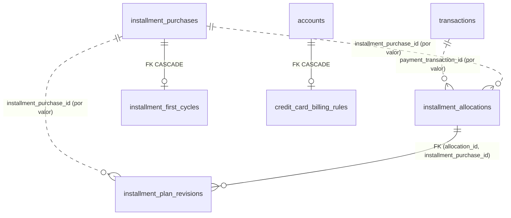

# Fase 1a.3B: migración 5 y persistencia de imputaciones

2 de noviembre de 2026. Rama `main`, commit base `9086c90` («fase 1a3A»), árbol limpio al empezar. Sin commit ni
push. Validación Android **preparada, no ejecutada** (sección 11).

## 1. Estado inicial

- `9086c90` contiene la Fase 1a.3A: `saveSQLiteRowPreservingIdentity.ts`, `sqliteCreditCardRepository` sin
  `INSERT OR REPLACE` y la validación Android de 1a.3A (`docs/validacion-fase1a3a/`: 223/223 en API 24 y API 35,
  0 diferencias Node–Android, 140 puntos de fallo por dispositivo). Esas cifras son la línea base anterior; **no**
  validan esta migración.
- Migraciones 1–4 en `src/database/migrations.ts`: un único `runSQLiteTransaction` para todas, una versión por
  bloque en `schema_migrations`, DDL con `IF NOT EXISTS`. Las tablas de las migraciones 3–4 también figuran en
  `SQLITE_SCHEMA_STATEMENTS` (fixtures completos) y `applySchema` las omite en instalaciones reales.

## 2. Flujos de eliminación y edición analizados (precondición D5/D6)

| Flujo actual | Qué borra o cambia | Efecto con una FK `NO ACTION` hacia compras/pagos |
|---|---|---|
| `deleteManualTransactionInScope` (compra) | `DELETE installment_purchases` explícito y luego `DELETE transactions` | **Fallaría**: toda compra migrada tiene revisión 0 |
| `saveTransactionInstallments` a 1 cuota o a débito | `deleteInstallmentPurchasesByTransactionId` | **Fallaría** igual |
| Edición de condiciones (3 → 6 cuotas) | `UPDATE` en sitio (1a.3A): reinicia `paid_installments` y `monthly_amount` | No afecta a la FK, pero la revisión 0 quedaría obsoleta en silencio |
| `updateInstallmentPurchasesAccount` | Cambia `account_id` | Igual que el anterior (cambia el calendario) |
| Borrado de un pago `creditCardPayment` | `DELETE transactions` | Fallaría si hubiera imputaciones |
| `transactions → installment_purchases` `ON DELETE CASCADE` | Borra la compra si alguien borra el movimiento sin pasar por el caso de uso | Con `CASCADE` en las tablas nuevas, borraría historial (prohibido por D5) |
| Borrado financiero | `DELETE` por tabla en orden | Requiere que las tablas nuevas vayan antes que compras y movimientos |

Conclusión: ni `CASCADE` (borra historial, D5) ni `NO ACTION` (bloquea dos flujos legítimos) ni `SET NULL`
(modifica el historial y chocaría con el trigger de solo inserción) cumplen los seis requisitos.

## 3. Política elegida: referencias históricas por valor con guardas activas

1. `installment_allocations` e `installment_plan_revisions` guardan `payment_transaction_id` e
   `installment_purchase_id` **por valor, sin FK** hacia `transactions` ni `installment_purchases`. Ningún borrado
   las arrastra ni las modifica; tampoco bloquean los flujos actuales.
2. La integridad que daría una FK se aplica con triggers donde importa:
   - al **insertar**, la compra (y el pago, que debe ser `creditCardPayment` a la tarjeta de la compra y en su moneda)
     tienen que existir;
   - una imputación **activa** impide borrar su pago o su compra y cambiar importe, moneda, tipo, dirección,
     estado o cuentas del pago. El caso de uso futuro debe revertirla explícitamente en la misma transacción
     (requisito 4); revertida, ya no bloquea y queda como historial;
   - cambiar el `id` de una compra o pago con historial se rechaza (rompería la referencia por valor).
3. Historial de solo inserción, sin borrar ni sobrescribir:
   - `installment_plan_revisions`: `UPDATE` abortado por trigger; número de revisión exactamente `máx + 1`
     (impide huecos, reescrituras e `INSERT OR REPLACE` sobre una revisión existente); `id` determinista
     `"<compra>:revision:<n>"` comprobado por `CHECK`.
   - `installment_allocations`: la única actualización admitida es `active → reversed` con `reversed_at`.
4. Eventos del ciclo de vida de la compra como **revisiones nuevas** (triggers sobre `installment_purchases`, solo si
   la compra ya tiene historial):
   - borrarla añade `purchaseRemoval` (`pendingVerification`, `purchaseRemoved`), que cierra el plan vigente;
   - cambiar total, cuotas, moneda, tarjeta, movimiento o `first_due_date` añade `purchaseEdit`
     (`pendingVerification`, `termsChanged`) con los valores heredados nuevos en `basis_*`. Es la «revisión
     correctiva pendiente de verificar» de D6; la edición nunca se bloquea por una revisión confirmada.
   - Una compra recreada con el mismo `id` (cuotas → 1 → cuotas) no hereda el plan eliminado: tras una
     `purchaseRemoval` solo se admite una nueva revisión `original` (nueva «encarnación»).
5. Solo el borrado financiero elimina estas filas; va antes de compras y movimientos, de modo que guardas y
   triggers de historial ya no encuentran nada (mismo precedente que `shared_loss_events`).
6. Metadatos de facturación (sección 5): `CASCADE`, porque son atributos de la fila actual y no historial.

Todo ocurre en la transacción del llamador: los triggers no añaden `executeSql` ni puntos de escritura nuevos.

**Compatibilidad con D6.** La guarda de imputaciones activas no bloquea un pago por tener una revisión posterior
confirmada; bloquea solo el borrado directo mientras exista una imputación activa sin revertir. El contrato para la
fase que active imputaciones es: «revertir (revisión `allocationReversal` pendiente de verificar) y luego editar o
borrar el pago, en una transacción». **Punto para confirmar por el propietario**: si D6 exige que el borrado *sin*
reversión previa funcione, la guarda debe sustituirse por una reversión automática en el trigger; hoy no se
eligió porque calcular la revisión correctiva es lógica de dominio de la Fase 1b.

## 4. Diseño de tablas

### `installment_allocations`

| Columna | Restricción |
|---|---|
| `id` | PK texto no vacío |
| `payment_transaction_id`, `installment_purchase_id` | Texto no vacío; existencia comprobada al insertar |
| `amount_cents` | `INTEGER`, `typeof = 'integer'`, `1 … 2^53−1` (rechaza 0, negativos, reales y texto no numérico) |
| `mode` | `unspecified` · `reduceTerm` · `reduceInstallment` (sin cálculos) |
| `status`, `reversed_at` | `active` ⇔ `reversed_at IS NULL`; nueva siempre `active` |
| `command_id` | `UNIQUE(command_id, installment_purchase_id)`; un comando imputa un solo pago (trigger) |
| `created_at` | No nulo |

Índices: `(installment_purchase_id, status)`, `(payment_transaction_id, status)`; el `UNIQUE` sirve las búsquedas
por comando. Un mismo pago admite varias imputaciones parciales (a varias compras, o a la misma desde comandos
distintos). Si el pago se elimina tras revertir la imputación, la fila queda `reversed` con el `id` del pago como
referencia histórica.

### `installment_plan_revisions`

| Columna | Restricción |
|---|---|
| `id` | `= installment_purchase_id || ':revision:' || revision_number` |
| `revision_number` | Entero ≥ 0, único por compra, secuencial (trigger); 0 ⇒ `original` |
| `source` | `original` · `allocation` · `allocationReversal` · `statement` · `purchaseEdit` · `purchaseRemoval` |
| `allocation_id` | Obligatorio solo en `allocation`/`allocationReversal`; FK compuesta a la imputación **de la misma compra** |
| `remaining_principal_cents`, `installment_amount_cents` | Enteros seguros ≥ 0 o `NULL` (inexacto o desconocido) |
| `remaining_installments` | Entero 0–360 o `NULL` |
| `effective_cycle_end` | Fecha civil exacta (`CIVIL_DATE_CHECK`, mismas reglas que `parseCivilDate`, sin `date()`) o `NULL`; obligatoria en `statement` |
| `verification` | `confirmed` · `projected` (ambos exigen importes, cuotas y ciclo) · `pendingVerification` (exige `pending_reasons`) · `estimated` |
| `pending_reasons` | Códigos separados por coma, solo con `pendingVerification` |
| `basis_total_amount`, `basis_monthly_amount`, `basis_installment_count` | Valores heredados **sin redondear**; obligatorios en `original`/`purchaseEdit`, nulos en el resto |

Semántica: `confirmed` = respaldado por extracto o usuario; `projected` = completo con reglas por defecto, nunca
presentado como confirmado; `pendingVerification` = falta o es inexacta información (motivo explícito);
`estimated` = simulación futura (p. ej. con intereses).

### Metadatos D1

- `credit_card_billing_rules(account_id PK → accounts CASCADE, closing_day_purchase_policy NULL|closingCycle|nextCycle)`.
  Sin fila o `NULL` = sin definir; no se asigna ninguna política automáticamente.
- `installment_first_cycles(installment_purchase_id PK → installment_purchases CASCADE, cycle_end, source user|statement)`.
  Por compra, nunca por tarjeta. Sin `closingDay` el calendario sigue pendiente (lo decide el motor de 1a.1).

Se eligieron tablas nuevas en lugar de columnas en `installment_purchases`/`credit_card_profiles` para no alterar
`compras-cuotas.csv` (`SELECT *`) y no exigir una tasa de interés para guardar la política. Ambas usan
`saveSQLiteRowPreservingIdentity` (mismo `rowid` y `created_at`); editar el plan por los flujos de 1a.3A conserva
la primera cuota confirmada porque el `UPDATE` en sitio no dispara el `CASCADE`.

## 5. Migración 5

`src/database/migrations.ts`, en la misma transacción que las versiones 1–4:

1. Tablas, índices y triggers propios de las tablas nuevas (`INSTALLMENT_HISTORY_TABLES`).
2. `SELECT` de las compras sin revisiones, ordenadas por `id`; revisión 0 por compra con
   `buildOriginalInstallmentRevision` (`toExactCopCents`), insertadas en lotes de 100 filas (900 parámetros,
   por debajo de los 999 de API 24).
3. Guardas y triggers de historial sobre `transactions` e `installment_purchases`.
4. Triggers de `financial_data_revision` de las tablas nuevas, **al final**: la línea base migrada no marca el
   respaldo como desactualizado (el contador queda igual).
5. `INSERT INTO schema_migrations VALUES (5, …)`.

Revisión 0 = condiciones conocidas al migrar, no una historia reconstruida: principal y cuota en centavos exactos o
`NULL`, cuotas del plan si son 1–360, `effective_cycle_end = NULL`, siempre `pendingVerification` con
`firstCycleUnconfirmed` (antes de la migración 5 no existía confirmación del primer ciclo) y, si procede,
`inexactHistoricalAmount`, `inexactInstallmentAmount`, `invalidPrincipal` o `invalidInstallmentCount`. La cuota
guardada es la heredada `Math.round(total / n)`, no la del motor D2. No se leen `paid_installments` ni `status`.
No se modifica ninguna fila existente.

SQL limitado a 3.9.2: `CHECK`, índices, FK compuestas, triggers con `WHEN`, `RAISE`, `IS NOT`, `substr`/`GLOB`/`CAST`,
`INSERT` multifila. Sin `ON CONFLICT`, `RETURNING`, `UPSERT`, ventanas, `WITHOUT ROWID`, columnas generadas ni
`INSERT OR REPLACE` (una prueba lo verifica sobre el texto del esquema y de la migración).

## 6. Repositorios

`createSqliteInstallmentHistoryRepository` (`src/modules/creditCards/repositories/`), sin conexión a pantallas,
hooks ni pagos:

| Método | Notas |
|---|---|
| `getAllocationsByPurchase` / `ByPayment` / `ByCommand` | Orden `created_at, id` |
| `saveAllocations(commandId, allocations)` | Lee y escribe en un programa; repetición idéntica = `replayed` sin escrituras; contenido distinto = error |
| `getPlanRevisions`, `getLatestPlanRevision` | Orden por número |
| `appendPlanRevision` | Calcula `máx + 1`, `INSERT` simple; rechaza `purchaseEdit`/`purchaseRemoval` (solo triggers) |
| `getBillingRules` / `saveBillingRules`, `getFirstCycles` / `saveFirstCycle` | Lotes de 900 ids; actualización con identidad |

Todas las escrituras usan el `database` recibido: dentro de `runSharedSQLiteTransaction` se unen al propietario
(un `BEGIN`, sin anidar); fuera, `runSQLiteTransaction` abre una transacción local. El caso de uso puro
`selectEffectivePlanRevision(history, cycleEnd?)` interpreta el historial: última encarnación, la revisión de mayor
número cuyo ciclo ya empezó; `removed` tras `purchaseRemoval`; revisiones de ciclos posteriores como `scheduled`.

No se implementan `registerExtraordinaryInstallmentPayment`, reversiones, amortización ni la regla R9 (ninguna
restricción relaciona la suma de capital con la deuda de la tarjeta).

## 7. Respaldos, CSV, restauración y borrado

| Mecanismo | Efecto |
|---|---|
| Respaldo SQLite físico (`localDatabaseSnapshot`) | Copia el archivo completo: incluye las tablas nuevas sin cambios de código |
| CSV de Drive (`SmartFinBackupCsv.kt`) | Lista fija de consultas; **sin cambios**. `compras-cuotas.csv` es idéntico (no hay columnas nuevas en `installment_purchases`). Las tablas nuevas **no** se exportan a CSV: limitación documentada, igual que el diario de pérdidas |
| Restauración | No existe restauración en la app. Una base v4 restaurada se migra al abrir; una base v5 en una app anterior abre con sus triggers activos y la app antigua no escribe en las tablas nuevas (ver riesgos) |
| Borrado financiero | Cuatro tablas añadidas al orden (40 `DELETE`, un `COMMIT`) |
| `financial_data_revision` | Triggers en las cuatro tablas (revisiones: `INSERT`/`DELETE`) |

## 8. Pruebas y resultados

`__tests__/installmentHistoryPhase1a3B.test.ts` (49 pruebas, bases sintéticas):

- **Esquema**: la base v4 se reproduce exactamente al quitar los objetos de la migración 5; instalación nueva por
  la ruta real de `applySchema` = mismo esquema; ausencia de SQL posterior a 3.9.2.
- **4 → 5 con datos**: compras creadas por los casos de uso (300.000×3, 1.234,56×6, 1 cuota), pago de tarjeta y
  filas heredadas sintéticas (0,1+0,2; 0 cuotas; 400 cuotas; 2^47). Estado completo antes/después (todas las
  tablas, saldos, deuda, patrimonio, ingresos, gastos, extractos, movimientos, contador de respaldo) idéntico salvo
  las tablas nuevas y `schema_migrations`; revisión 0 exacta por compra.
- **Repetición**: segunda y tercera ejecución sin escrituras ni cambios.
- **Atomicidad**: 15 puntos (4 tablas, 2 índices, triggers de validación, lectura de compras, lote de revisiones,
  guardas, triggers de historial y de respaldo, registro de versión) × antes/después = 30 casos: estado y esquema
  iguales a v4, versión 4, y el siguiente arranque migra correctamente.
- **Integridad**: solo inserción, secuencia, `INSERT OR REPLACE` rechazado, `CHECK` de verificación, importes,
  modos, estados, compra/pago/tarjeta, comando, transición de estado, FK compuesta.
- **Flujos actuales**: la misma secuencia (crear, editar 3 → 6, pagar, borrar pago, borrar compra) produce en v4 y
  v5 las **mismas escrituras SQL** y el mismo estado financiero; v5 añade solo `purchaseEdit` y `purchaseRemoval`
  (+2 en el contador de respaldo). Edición sin cambio de condiciones: sin revisión nueva, identidad conservada.
  Recreación de compra; imputación activa que bloquea y se desbloquea tras revertir; borrado financiero.
- **Repositorios**: numeración, validaciones, idempotencia, identidad en metadatos, participación en el ámbito
  compartido (un `BEGIN`, rollback completo).
- **Volumen**: 2.000 compras repartidas en 50 años migradas en una transacción.

Expectativas existentes actualizadas por el cambio de esquema (sin cambios de comportamiento):
`financialDataRepository.test.ts` y `financialAtomicityPhase5E.test.ts` (36 → 40 `DELETE`; 38 → 42 escrituras
también en `financialDeletionPhase5C.test.ts`), `sharedForgiveness.test.ts`, `sharedExpenses.test.ts` y
`subscriptions.test.ts` (versiones `[1…5]`) y el
snapshot de `financialAtomicityPhase0` (cuatro tablas vacías, fila de versión 5 y hashes de estado derivados;
ninguna escritura añadida, quitada ni reordenada).

Resultados finales: sección 13.

## 9. Invariantes financieros

La migración solo lee `installment_purchases` e inserta en tablas nuevas. Comprobado por igualdad completa de
estado (todas las columnas de todas las tablas): saldos, deuda, patrimonio, ingresos, gastos, ahorro, extractos,
movimientos, cupos y `financial_data_revision`. La migración no ejecuta ningún `UPDATE` ni `DELETE` sobre tablas
existentes, así que tampoco cambia `rowid`. Los flujos posteriores escriben exactamente el mismo SQL.

## 10. Riesgos restantes

1. **Compras creadas después de la migración no tienen revisión 0**: crearla cambiaría el número de escrituras de
   `saveTransactionInstallments` y los puntos de fallo validados en Android. La Fase 1a.4 debe crearla al dar de
   alta (o de forma perezosa antes de la primera imputación), con `appendPlanRevision`.
2. **Guardas frente a D6** (sección 3): confirmar el contrato «revertir y luego borrar/editar».
3. **App anterior sobre base v5** (degradación): la app v4 no conoce las tablas, pero los triggers siguen activos;
   un borrado de compra con historial añade su `purchaseRemoval` (correcto) y nada la bloquea mientras no haya
   imputaciones activas, que hoy no se crean. Si en el futuro existen imputaciones activas, una app antigua no
   podría borrar ese pago (fallo visible, no corrupción).
4. **Tablas nuevas fuera del CSV**: se conservan en el respaldo SQLite; exportarlas a CSV exige cambiar el
   formato publicado con aviso.
5. `created_at` de las revisiones creadas por triggers usa el reloj de SQLite (UTC), no el reloj de dominio.
6. Sin evidencia de dispositivo (API 24 = SQLite 3.9.2) hasta ejecutar la sección 11.

## 11. Validación Android pendiente

Preparada en [validacion-fase1a3b/README.md](validacion-fase1a3b/README.md): campañas, oráculo Node verificado,
workspace `C:/sf-1a3b-20261102` y atestación `7a3fc303…`. No se ha compilado ni ejecutado nada en dispositivos;
requiere autorización específica. D6: se conservan las guardas; el contrato futuro revierte las imputaciones activas
y crea las revisiones correctivas antes de editar o eliminar el pago, en una única transacción.

## 12. Preparación para la Fase 1a.4

- Crear la revisión 0 de compras nuevas y su `effective_cycle_end` cuando el motor de 1a.1 lo determine
  (`projected` o `confirmed` según `installment_first_cycles` y `credit_card_billing_rules`).
- Caso de uso `registerExtraordinaryInstallmentPayment` sobre `saveAllocations` + `appendPlanRevision` en un único
  ámbito compartido (modo `unspecified`).
- Reversión: `UPDATE … status='reversed'` + revisión `allocationReversal` pendiente, antes de editar o borrar el pago.
- Decidir la exportación CSV de las tablas nuevas.

## 13. Resultados de verificación

| Verificación | Resultado |
|---|---|
| `npx jest __tests__/installmentHistoryPhase1a3B.test.ts` | 49/49 |
| Regresiones 1a.2 y 1a.3A (`creditCardStatementsPhase1a2`, `phase1a2StatementsProbes`, `safePersistencePhase1a3A`, `phase1a3aAndroidEquivalence`, `phase6b3HarnessRollbackOracle`) | Verdes, sin cambiar sus referencias Node |
| `npm test -- --runInBand` | 84 suites aprobadas y 7 omitidas; 1.246 pruebas aprobadas, 14 omitidas, 0 fallos; 8/8 snapshots |
| `npm run test:reproductions -- --runInBand` | 6 suites, 29/29 |
| `npx tsc --noEmit` | Sin errores |
| `npm run lint` | 0 errores; las 5 advertencias previas en `scripts/phase5e3`, `phase6a` y `phase6b` |
| `git diff --check` | Limpio |

## 14. Corrección de fechas tras la validación r3

En SQLite 3.9.2 (API 24), `CHECK(length(x) = 10 AND date(x) IS x)` aceptó `2026-02-30` y `2026-02-29`: esa versión
devuelve sin cambios una fecha imposible. Con autorización del propietario, `CIVIL_DATE_CHECK` usa ahora solo
operaciones de texto y aritmética (`typeof`, `length`, `GLOB`, `substr`, `CAST`, `CASE`): formato exacto
`YYYY-MM-DD`, año 0001–9999, mes 1–12, día según el mes y año bisiesto gregoriano, igual que `parseCivilDate`. El
`CASE … THEN 1 ELSE 0 END = 1` impide que un resultado `NULL` cuente como aprobado. Afecta solo a
`installment_plan_revisions.effective_cycle_end` (puede seguir siendo `NULL`) e `installment_first_cycles.cycle_end`
(`NOT NULL`). La migración 5 nunca se ha publicado ni aplicado a una base real (archivos sin commit; `com.smartfin`
actualizada por última vez el 11 oct 2026), por lo que se corrige su definición sin migración correctiva. Detalle y
pruebas: [validacion-fase1a3b/README.md](validacion-fase1a3b/README.md), sección 15.
